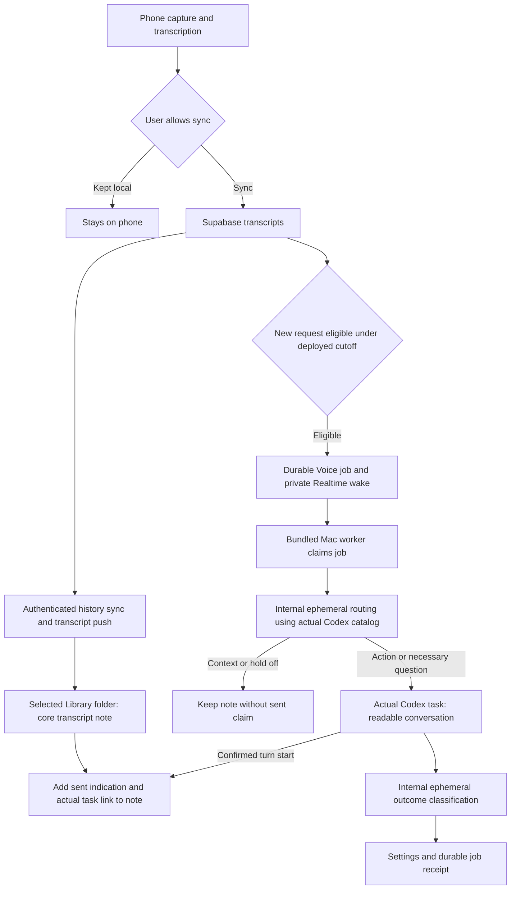

# Field Theory Voice to Codex

Field Theory uses authenticated Supabase push and a worker bundled into the Mac app. Users install Field Theory and Codex, sign into both, and enable Voice requests. They do not need Node, Python, a development checkout, a webhook, or a tunnel. The Mac must be awake, online, and running Field Theory.

## Installed version and next candidate

The installed `0.3.47-voice.2` preview and deployed Voice backend already delivered a synthetic arithmetic request and a real phone request to Codex. The real request produced the mountain illustration and a visible Settings summary, but no Library note. Those observations remain recorded in the [production activation receipt](VOICE_PRODUCTION_ACTIVATION.md).

The user subsequently authorized the minimal Inbox iteration described below. Its source passed combined verification; it is **not evidence of a newly packaged or installed preview**. The [combined scope audit](VOICE_COMBINED_PREVIEW_SCOPE.md) records source commits, verification boundaries, and pending acceptance. Locked-screen and sleep/reconnect behavior still need physical verification.

## Candidate flow

## Library receipt

On first setup, the app creates or reuses Library `Inbox` and selects it. A previous folder choice is retained, including a legacy choice outside Library; a missing previous folder requires a new choice. New choices come from the Library folder picker. Users can rename the selected folder or select another Library folder while Voice requests are paused.

Each synced recording gets one stable local Markdown note containing its core transcript. Updates preserve user edits through section hashes and the existing document conflict guard. The note gains only a sent indication and a clickable `codex://threads/<actual-task-id>` link after an actual turn start is confirmed. Historical jobs may supply that link only with a real task ID and a saved turn ID or completed status. Task creation and the backend dispatch boundary alone do not prove it was sent.

Inbox contains no copied images, artifacts, final answers, or ongoing progress dashboard. The useful answer and requested media stay in the actual Codex conversation. Historical or context-only recordings remain findable as notes without a fabricated sent state or destination. The existing mountain task can be linked from its confirmed historical receipt without repeating its request or copying its image.

History materialization works independently of the Voice execution toggle. It subscribes before catch-up, uses bounded authenticated pages, and fully reconciles transcripts and confirmed jobs on startup/reconnection. Ordinary events use durable cursors with timestamp-tie handling. Account changes fence pending writes. There is no scheduled polling and no execution call in history import.

## Execution and routing

New execution retains the deployed cutoff, baseline, revision deduplication, generation, and lease rules. Importing old recordings never claims or replays them. The cutoff is the phone's transcript-creation clock, not a verified microphone-start clock: old audio transcribed after enabling may qualify. Recordings explicitly kept local on the phone never reach this backend.

Codex selects a destination from a bounded catalog of actual saved projects and recent tasks with available local folders. A clear follow-up may continue an existing task; independent work may create a task in a selected project; a general request may use a projectless task. A transcript revision keeps its recorded task even when that task is outside the recent catalog. Unavailable or invented destinations are rejected, and unresolved intent produces a necessary question. Active tasks and inherited permissions remain subject to the runner's continuation checks. The catalog is not an exhaustive search of every older task.

Routing and outcome classification use internal ephemeral turns with work tools disabled. The primary task receives the recording as normal text and responds in plain language or Markdown. It is not forced to show a JSON application receipt. Existing Settings still retain the latest outcome, answer, and actual clarification; the new Library receipt remains minimal. See the [runner contract](VOICE_CODEX_RUNNER.md).

Actual task identity is recorded before the backend dispatch boundary and before `turn/start`. Working and the sent link require the actual `turn/started` event. Interrupted work is reconciled in its recorded task instead of blindly repeating its prompt; ambiguous recovery holds later revisions for attention. A completed clarification can accept a later reply.

The private job wake carries identifiers only. Reconnection reconciles durable work because Broadcast does not replay history. Active leases and one-time retry deadlines remain bounded worker mechanisms, not transcript polling. The previous personal five-minute inbox automation was paused during production activation and remains preserved.

## Verification boundaries

The earlier installed preview has real hosted push and phone execution evidence. The candidate has focused source tests for Library persistence, account fencing, reconnect reconciliation, picker races, routing validation, readable primary turns, internal decisions, and task-link handling. Their exact evidence is tracked in the [combined scope audit](VOICE_COMBINED_PREVIEW_SCOPE.md).

The new preview still needs signed/notarized package verification, user installation, and visible Settings/Library acceptance. Locked-screen, sleep/offline recovery, crash-boundary recovery, and a full second-account runtime test remain pending. Historical test counts, package hashes, and live task receipts must not be represented as verification of the new combined source.
