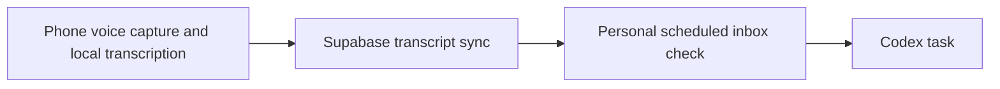
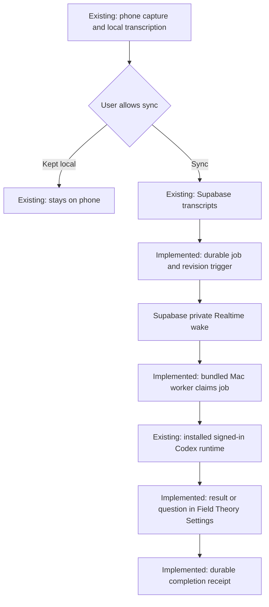

# Field Theory Voice to Codex

The selected design uses Supabase's authenticated push connection and a worker bundled into Field Theory. End users install Field Theory and Codex, sign into both, choose a permitted folder, and enable Voice requests. They do not install Node, Python, a development checkout, a webhook server, or a tunnel for this integration. The Mac must be awake, online, and running Field Theory. Screen locking should not require UI automation; the final live runner test happened while unlocked, so locked-screen acceptance is still pending.

## Existing path

The personal inbox automation was the previous workflow. It was paused during the authorized September 7, 2026 switch to native push to prevent duplicate dispatch. Its configuration and existing receipts are preserved.

## Installed path

The migration, private channel policy, bundled worker, Codex adapter, and Settings interface are installed and enabled for the user's selected folder. An authenticated synthetic transcript reached the installed Mac through native push, started one Codex task, and displayed its completed answer in Settings. A subsequent real phone recording produced a verified mountain illustration and visible completion summary. See the [production activation receipt](VOICE_PRODUCTION_ACTIVATION.md). Automatic artifact delivery into Library and locked-screen acceptance remain outstanding.

## Behavior

The worker discovers requests on subscription, reconnection, and push events. There is no periodic transcript query. Active jobs renew their leases; the server may provide a one-time wake deadline for an existing retry or expired lease. Reconnection reconciles the durable queue because broadcasts do not replay historical events.

Each transcript revision has a durable dispatch identity. Edits wait for running work and continue its recorded task. A separate recording is a separate request; cross-recording reply selection is not implemented. If an interrupted dispatch might already have executed, recovery reads its existing task instead of repeating the prompt. An uncertain recovery holds later revisions for attention.

Codex interprets the whole recording. Context, quoted instructions, and “hold off” must not execute tools. The interpretation can still create a Codex task. Field Theory only displays Working after an actual turn-started event, and it retains the full final answer and concrete clarification question locally. Native Open task navigation remains disabled until verified; results can be read in Settings.

The selected folder is the Codex working directory, not an enforced output destination. The real illustration request saved its PNG in Codex's generated-image store and returned a description without a link. The runner currently drops image-generation artifact metadata, so nothing appeared in Library Inbox. Reliable artifact capture, links, and Library delivery need a separate fix; the user requested diagnosis only at this stage.

Enabling excludes existing transcript IDs and uses a transcript-creation cutoff. The phone currently timestamps the transcript after transcription, rather than recording microphone-start time. Therefore old raw audio transcribed after enable can qualify; strict microphone-time exclusion is not claimed. Recordings explicitly kept local on the phone never reach this backend.

## Verification and activation

- Database: 20 real Postgres-in-WASM tests; authenticated identities and WebSocket transport are fixtures. RLS, owner fencing, revisions, leases, pause ordering, and failed wake transactions are covered.
- Mac: 102 focused Voice tests covering runner protocol, worker lifecycle, Settings, and trusted IPC. Type checks pass.
- Real Codex: the final source completed one arithmetic turn, `17 + 25 = 42`, after durable receipts and an actual start event. Earlier continuation and read-only recovery also succeeded. See [runner evidence](VOICE_CODEX_RUNNER.md).
- Packaged local installation: follow the approved [local install record](VOICE_LOCAL_INSTALL.md). Development Electron launches were stopped following reported macOS warnings; no security bypass is permitted.
- Hosted activation: explicitly authorized and completed on September 7, 2026. The installed app reports Ready; authenticated push, actual Codex execution, visible completion, owner access checks, and same-text deduplication passed. The old personal polling workflow is paused. The [migration and rollback runbook](VOICE_EVENT_BACKEND.md) retains the remaining physical and recovery acceptance steps.

## Deferred user experience request

The user requested a future automatically created Library Inbox, selected by default, plus a folder picker showing Field Theory Library folders. They explicitly asked to record this idea without starting implementation. The current activation preserves the folder they already selected.
