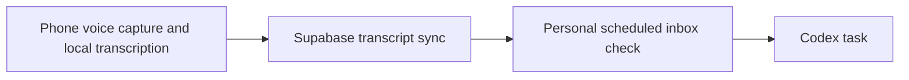
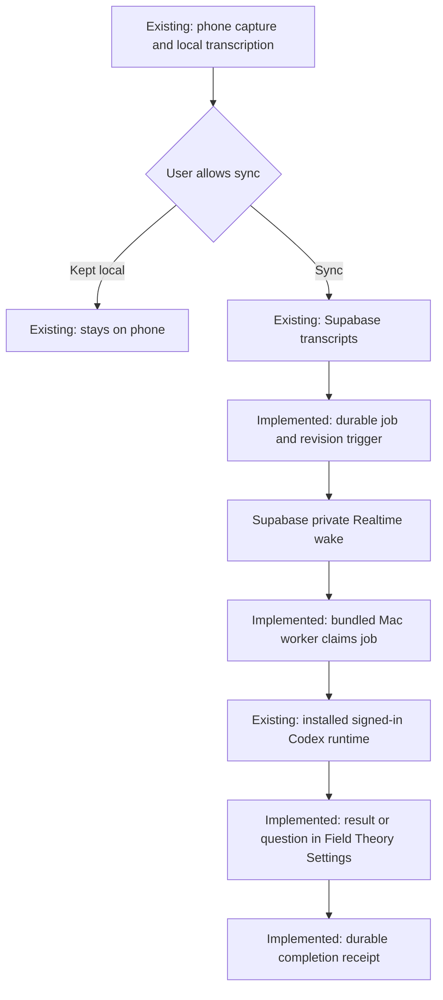

# Field Theory Voice to Codex

The selected design uses Supabase's authenticated push connection and a worker bundled into Field Theory. End users install Field Theory and Codex, sign into both, choose a permitted folder, and enable Voice requests. They do not install Node, Python, a development checkout, a webhook server, or a tunnel for this integration. The Mac must be awake, online, and running Field Theory. Screen locking should not require UI automation; the final live runner test happened while unlocked, so locked-screen acceptance is still pending.

## Existing path

The personal inbox automation is a separate existing workflow. It has not been changed or disabled by this implementation.

## Candidate path

The migration, private channel policy, bundled worker, Codex adapter, and Settings interface are implemented. The migration has **not** been applied to a hosted project. Local package installation does not activate delivery. A real phone-to-hosted-Supabase-to-installed-Mac canary remains necessary before calling this ready for users.

## Behavior

The worker discovers requests on subscription, reconnection, and push events. There is no periodic transcript query. Active jobs renew their leases; the server may provide a one-time wake deadline for an existing retry or expired lease. Reconnection reconciles the durable queue because broadcasts do not replay historical events.

Each transcript revision has a durable dispatch identity. Edits wait for running work and continue its recorded task. A separate recording is a separate request; cross-recording reply selection is not implemented. If an interrupted dispatch might already have executed, recovery reads its existing task instead of repeating the prompt. An uncertain recovery holds later revisions for attention.

Codex interprets the whole recording. Context, quoted instructions, and “hold off” must not execute tools. The interpretation can still create a Codex task. Field Theory only displays Working after an actual turn-started event, and it retains the full final answer and concrete clarification question locally. Native Open task navigation remains disabled until verified; results can be read in Settings.

Enabling excludes existing transcript IDs and uses a transcript-creation cutoff. The phone currently timestamps the transcript after transcription, rather than recording microphone-start time. Therefore old raw audio transcribed after enable can qualify; strict microphone-time exclusion is not claimed. Recordings explicitly kept local on the phone never reach this backend.

## Verification and activation

- Database: 20 real Postgres-in-WASM tests; authenticated identities and WebSocket transport are fixtures. RLS, owner fencing, revisions, leases, pause ordering, and failed wake transactions are covered.
- Mac: 102 focused Voice tests covering runner protocol, worker lifecycle, Settings, and trusted IPC. Type checks pass.
- Real Codex: the final source completed one arithmetic turn, `17 + 25 = 42`, after durable receipts and an actual start event. Earlier continuation and read-only recovery also succeeded. See [runner evidence](VOICE_CODEX_RUNNER.md).
- Packaged local installation: follow the approved [local install record](VOICE_LOCAL_INSTALL.md). Development Electron launches were stopped following reported macOS warnings; no security bypass is permitted.
- Hosted activation: the [migration and rollback runbook](VOICE_EVENT_BACKEND.md) contains preflight, application, isolation, and physical acceptance steps. This needs separate authorization. Only after the real canary succeeds should the old personal polling workflow be retired.
