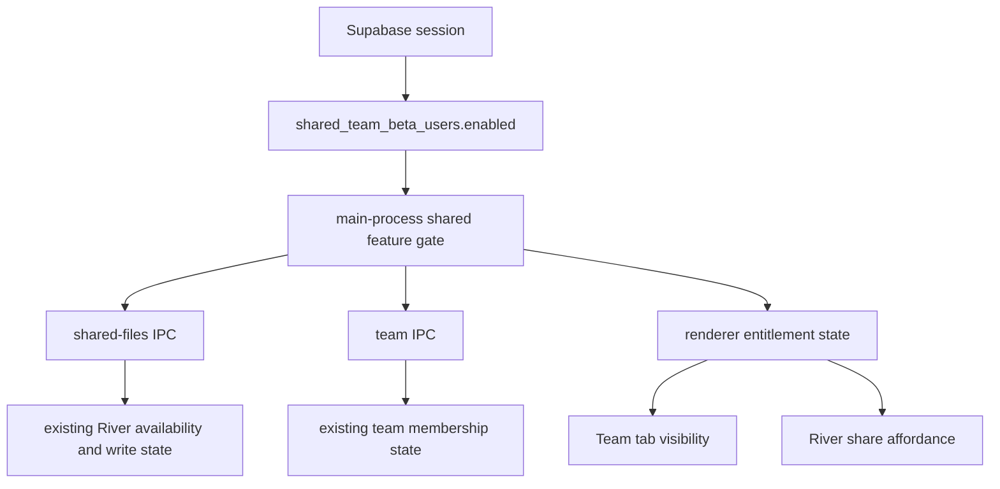

# feat: Gate Teams and River with shared team beta entitlement

## Summary

Wire the existing `shared_team_beta_users` database entitlement into the existing Teams and River gates.
The first slice reuses current auth, team state, River availability, and refresh plumbing while keeping Teams and River hidden for unentitled users.
This is a launch gate, not the long-term sharing model: it should move the app toward one River per person that can later receive documents from individual contacts, many contacts, teams as contact groups, or room-like scopes.

---

## Problem Frame

Teams and River already exist in the Mac app, with auth checks, membership state, availability state, and refresh hooks already in place.
The current UI visibility mostly follows team membership state.
That is too broad for a limited rollout because any authenticated user with matching team/contact state can discover the Team settings surface or River sharing controls.

The attached schema already includes `public.shared_team_beta_users(user_id, enabled)`.
The app should use that existing table as the beta entitlement answer, then apply that answer consistently in the main process and renderer.
The gap is not database design; the gap is that app code never reads `shared_team_beta_users`.

---

## Requirements

**Access control**

- R1. Users without an active Supabase session must not see the Team settings tab or River sharing affordances.
- R2. Authenticated users without an enabled `shared_team_beta_users` row must not see the Team settings tab or River sharing affordances, even if team/contact rows exist.
- R3. Authenticated users with the entitlement must see the Team settings tab when their app session is active.
- R4. Entitled users must be able to use the existing River share button and Team settings actions subject to the current team membership rules.
- R4a. Entitlement code must not assume a user can only ever belong to one team; the current one-team River behavior may remain for this rollout, but new access code should leave room for many teams, contact-based sharing, and River filtering.

**State, refresh, and offline continuity**

- R5. Entitlement state must refresh on auth session changes and when team state changes.
- R6. Entitlement lookup failures must use a last-known allowed entitlement for the current signed-in user when the failure is network/offline-shaped.
- R7. Existing local River cache files may remain readable as local files, but the app must not expose new River write/share controls unless entitlement is present.
- R8. Users who were previously entitled must not lose the Team tab or River surfaces just because the laptop temporarily loses internet access.

**Boundary**

- R9. The app must not rely on local feature flags alone for this rollout.
- R10. The implementation must preserve local-first unauthenticated app workflows.

---

## High-Level Technical Design

The new entitlement answers "may this account use Teams/River at all."
The existing auth, team membership, River availability, and refresh logic still answers "who is signed in," "what team scope applies," "can this user write," and "when should state reload."
The longer-term River model should treat each person's River as a destination that can aggregate shared documents from multiple future scopes.
Those scopes should include one contact, many selected contacts, and teams that are simply named groupings of contacts.

---

## Key Technical Decisions

- **Use the existing beta entitlement table:** The app should read `shared_team_beta_users.enabled` from Supabase for the current user. This matches the database design already present in the schema and avoids inventing a parallel feature flag system.
- **Keep entitlement separate from team membership:** Entitlement controls whether the surface exists. `SharedTeamService` continues to resolve owner/member/invite state after the gate passes.
- **Do not use `contacts` as the rollout gate:** `contacts` answers "who is on this team." It should not answer "is this account allowed into the Teams/River beta."
- **Do not use `team_documents` as the rollout gate:** `team_documents` is the River transport/cache source. It should not decide whether the account may see the feature.
- **Treat single-team River as current behavior, not the product ceiling:** Existing services still resolve one active team scope today. Entitlement should not add new assumptions that make many teams, contact shares, or room-like scopes harder to add next.
- **Model future Teams as contact groups:** A Team should become a grouping over mutually approved contacts, not the only way to share. That keeps one-to-one, one-to-many, and team sharing in the same conceptual family.
- **River should become a filterable inbox:** Future River preferences should let someone include all contacts, specific contacts, selected teams, or exclude noisy teams without changing the underlying shared document records.
- **Make async entitlement explicit:** The current shared-feature helper is synchronous, but the entitlement read is database-backed. IPC handlers should await an entitlement resolver, while lifecycle helpers use a cached state that is refreshed on auth and entitlement-change events.
- **Gate in the main process and renderer:** Renderer gating keeps the UI clean. Main-process gating prevents hidden or stale renderer code from invoking Team/River IPC paths.
- **Keep last-known allowed access offline:** Missing auth and explicit not-entitled states hide affordances and block writes. Network/offline lookup failures keep the last-known allowed entitlement for the same user so Team/River does not disappear mid-trip.
- **Do not solve general River sharing yet:** Contact sharing, invite codes, rooms, and multi-team River filtering are follow-up product work. This plan only restores limited access to the existing Teams/River feature set.

---

## System-Wide Impact

The entitlement changes four surfaces that must stay consistent: Electron IPC, the browser-helper HTTP bridge, the preload/browser-library renderer bridge, and React UI state.
The main process is the enforcement boundary; renderer state is only a presentation cache.
The Library may still index local River cache files, but remote River operations and visible River controls must follow the entitlement gate.

---

## Dependencies / Prerequisites

- The production database must expose the existing `public.shared_team_beta_users` table to authenticated clients under RLS.
- The required client read is: current user can read only their own `shared_team_beta_users` row, and only `enabled` is needed by the app.
- Admin/manual rollout writes can stay outside the app; this client feature does not need user-facing beta management UI.
- The app must treat no row, `enabled = false`, denied read, missing table, or missing column as not entitled unless the failure is clearly network/offline-shaped and a same-user last-known allowed entitlement exists.
- The app may use a local last-known allowed entitlement only for the same signed-in user and only when the fresh entitlement read fails because the network or backend is unavailable.

---

## Implementation Units

### U1. Add the `shared_team_beta_users` entitlement resolver

**Goal:** Add the missing account entitlement predicate that existing Team/River gates can call.

**Requirements:** R1, R2, R3, R5, R6, R8, R9.

**Dependencies:** None.

**Files:**

- `mac-app/electron/main/sharedTeamEntitlementService.ts`
- `mac-app/electron/main/sharedTeamEntitlementService.test.ts`
- `mac-app/electron/main/authManager.ts`
- `mac-app/src/types/window.d.ts`

**Approach:** Create a small service that uses the existing `AuthManager` session and Supabase client to query `shared_team_beta_users` for `session.user.id`.
The concrete query should be equivalent to selecting `enabled` from `shared_team_beta_users` where `user_id = session.user.id`, then reading at most one row.
Return a typed state such as allowed, not authenticated, not entitled, and lookup failed.
Expose an async read for IPC handlers and a cached snapshot for lifecycle code that cannot await.
Persist the last-known allowed result by user ID so offline launches can keep Team/River visible for a previously entitled account.
Clear the cached entitlement on sign-out or user ID change.

**Execution note:** Implement the resolver test-first because this is the security boundary for the rest of the plan.

**Patterns to follow:** Match the defensive return-shape style in `sharedTeamService.ts`, the auth access pattern in `sharedSyncService.ts`, and the fail-closed IPC style already in `index.ts`.

**Test scenarios:**

- Authenticated user with `shared_team_beta_users.enabled = true` returns allowed.
- Authenticated user with `enabled = false` returns not entitled.
- Authenticated user with no `shared_team_beta_users` row returns not entitled.
- Missing Supabase client or missing session returns not authenticated.
- Supabase read error with no last-known allowed entitlement returns lookup failed and does not throw to callers.
- Supabase read error with last-known allowed entitlement for the same user returns allowed with a stale/offline marker.
- Explicit false entitlement overrides any previously cached allowed state after a successful online read.
- Successful no-row entitlement overrides any previously cached allowed state after an online read.
- Cached snapshot starts unavailable until the async entitlement read succeeds or a same-user last-known allowed entitlement is restored.
- Session change clears any cached entitlement result before the next read.

**Verification:** The resolver has focused unit coverage for every state and no renderer code reads Supabase directly for this entitlement.

### U2. Extend existing Team and River IPC gates

**Goal:** Add entitlement to the main-process Team/River guards that already check auth and read-only account mode.

**Requirements:** R1, R2, R4, R6, R7, R8, R9.

**Dependencies:** U1.

**Files:**

- `mac-app/electron/main/index.ts`
- `mac-app/electron/main/browserHelperServer.test.ts`
- `mac-app/electron/main/browserHelperServer.ts`
- `mac-app/electron/main/sharedSyncService.ts`
- `mac-app/electron/main/sharedSyncService.test.ts`
- `mac-app/electron/main/sharedTeamService.test.ts`

**Approach:** Extend the current authentication-only shared feature gate with entitlement-aware guards.
IPC handlers should await the entitlement resolver before calling shared/team services.
The browser-helper native bridge callbacks in `index.ts` should use the same entitlement-aware helper as the Electron IPC handlers; `browserHelperServer.ts` should remain a thin HTTP adapter around those callbacks.
Synchronous service-refresh code should use the cached entitlement snapshot and stay fail-closed while the entitlement is unknown, except when a same-user offline cache already marks the account allowed.
Shared-files availability should return unavailable with an entitlement-specific reason when the user is logged in but not entitled.
When entitlement is restored from last-known allowed state, shared-files availability may be visible but should surface offline/stale status so write failures can be explained honestly.
Team mutations and River write calls should fail closed with a clear unavailable error.
Keep existing `canWriteFieldTheoryContent()` read-only account checks layered after entitlement.
Ensure the browser-helper routes inherit the same native bridge behavior rather than bypassing the main-process gate.

**Patterns to follow:** Reuse the current IPC guard shape in `sharedFiles:*` and `team:*` handlers, and preserve the existing `afterTeamMutation()` broadcast behavior when a permitted mutation succeeds.

**Test scenarios:**

- `team:getState` returns unavailable with `not_entitled` when authenticated but not entitled.
- `team:getState` remains available when the same user has a last-known allowed entitlement and the entitlement read fails offline.
- `team:inviteMember`, `team:respondToInvite`, `team:removeMember`, and `team:leaveTeam` return errors when not entitled.
- `sharedFiles:getAvailability` returns unavailable with `not_entitled` when not entitled.
- `sharedFiles:getAvailability` remains visible but marked stale/offline when last-known allowed entitlement is used.
- `sharedFiles:share`, `sharedFiles:updateContent`, and `sharedFiles:setPinned` fail closed when not entitled.
- Browser-helper shared-files routes return the same unavailable states as Electron IPC for unentitled accounts.
- Browser-helper shared-files routes do not implement their own entitlement logic; they inherit it from the native bridge callbacks.
- Entitled users still flow through existing team membership checks, including pending invite read-only behavior.

**Verification:** Existing Team and River IPC paths still work for entitled users and cannot be used by authenticated but unentitled users in unit tests.

### U3. Add entitlement to renderer state

**Goal:** Add entitlement state to the renderer bridges that already expose auth, team changes, and River availability.

**Requirements:** R1, R2, R3, R5, R6, R8.

**Dependencies:** U1, U2.

**Files:**

- `mac-app/electron/main/index.ts`
- `mac-app/electron/preload.ts`
- `mac-app/src/browser-library.tsx`
- `mac-app/src/types/window.d.ts`
- `mac-app/src/hooks/useAuthSessionBridge.test.tsx`
- `mac-app/src/__tests__/browserLibraryApp.test.tsx`

**Approach:** Add a small renderer-facing API, likely on `teamAPI`, that returns the entitlement state and reuses existing auth/team change events to invalidate it.
The renderer should not infer entitlement from team membership.
It should preserve Team/River visibility when the entitlement state is allowed from a same-user offline cache.
It should ask for entitlement, then separately ask for team state and River availability when allowed.
`teamAPI.getState()` may also include entitlement metadata, but entitlement should remain a distinct field from `available` because `available` currently means a team scope exists or can be inferred from invites.

**Patterns to follow:** Follow the existing `authAPI.onSessionChanged`, `teamAPI.onTeamChanged`, and `sharedFilesAPI.getAvailability` event/request style.

**Test scenarios:**

- The browser-library bridge exposes the entitlement read method.
- Entitlement changes propagate to renderer listeners after auth session changes.
- A lookup failure is represented as not available rather than crashing renderer initialization.
- A same-user offline cached entitlement is represented as allowed but stale/offline so UI can stay visible without pretending the backend was reached.

**Verification:** Renderer code can distinguish not authenticated, not entitled, and allowed without querying Supabase directly.

### U4. Add entitlement to Settings and Library affordances

**Goal:** Add entitlement to the UI visibility rules that already depend on team state and River availability.

**Requirements:** R1, R2, R3, R4, R5, R7, R8, R10.

**Dependencies:** U3.

**Files:**

- `mac-app/src/components/SettingsPanel.tsx`
- `mac-app/src/components/LibrarianView.tsx`
- `mac-app/src/components/__tests__/SettingsPanel.test.tsx`
- `mac-app/src/__tests__/teamSettingsState.test.ts`
- `mac-app/src/components/__tests__/LibrarianView.test.tsx`

**Approach:** Replace `teamFeaturesVisible` with an entitlement-aware visibility decision built from the new entitlement state.
The Team section should appear only when entitlement is allowed; within that section, existing membership state still decides owner/member/invite content.
The River sharing shortcut row and Library toolbar share button should require entitlement plus existing shared-file availability/write state.
When a previously selected Team section becomes unentitled, redirect to Account as the current code already does for unavailable teams.
When the app is offline and entitlement was last-known allowed for the same user, keep the Team section and River surfaces visible and let existing Team/River operations report network failures as needed.

**Patterns to follow:** Preserve existing section filtering and `TeamSettings` state construction.
Preserve the current `sharedFilesAvailable && (sharedFilesCanWrite || sharedFileStatus.shared)` toolbar condition, with entitlement added ahead of it.

**Test scenarios:**

- Settings hides the Team nav item for authenticated but unentitled users.
- Settings shows the Team nav item for entitled users even before an accepted team member exists, so selected rollout users can invite teammates.
- Settings keeps the Team nav item visible after an entitled user loses internet access.
- Settings redirects away from Team if entitlement is revoked while the section is selected.
- The keyboard-shortcut row for River Sharing is hidden unless entitlement and shared-files availability are both true.
- The Library toolbar does not show "Add to River (shared)" when the user is not entitled.
- The Library toolbar does not show "Remove from River (shared)" for already-shared cache files when the user is not entitled.
- The Library toolbar still shows "Remove from River (shared)" for already-shared cache files when entitlement and main-process availability allow that operation.

**Verification:** UI tests prove the same entitlement state drives Team tab visibility and River share controls.

### U5. Document rollout and database prerequisite

**Goal:** Record the manual DB setup and rollout expectations without adding private schema to the OSS repo.

**Requirements:** R5, R6, R8, R9, R10.

**Dependencies:** U1.

**Files:**

- `mac-app/PRIVACY_POLICY.md`
- `mac-app/docs/ARCHITECTURE.md`
- `mac-app/README.md`

**Approach:** Add a short note that Teams/River is account-backed and entitlement-gated.
Document that production DB/RLS owns the eligibility flag, and that the Mac app fails closed when it cannot read it.
Document the offline continuity rule: last-known allowed access keeps local UI visible for the same signed-in user, but successful online revocation wins when it can be read.
Keep private production schema details out of the public repo.

**Patterns to follow:** Follow the existing account-backed feature language in `mac-app/README.md` and `mac-app/PRIVACY_POLICY.md`.

**Test scenarios:** Test expectation: none -- documentation-only unit.

**Verification:** Docs explain the entitlement boundary without exposing private Supabase internals.

---

## Scope Boundaries

### In Scope

- Gate Team settings visibility.
- Gate River add/share UI affordances.
- Gate Team and River IPC read/write paths in the main process.
- Read entitlement from the authenticated account's `shared_team_beta_users` row.
- Preserve existing team membership and River sync behavior after entitlement passes.

### Deferred to Follow-Up Work

- Contact-to-contact River sharing.
- One-to-many River sharing to selected contacts.
- Mutual contact approval flow before either side can share into the other's River.
- Invite-code or room-code sharing.
- Multiple River rooms or multiple team filters.
- Many-team River membership and filtering.
- A single personal River inbox that aggregates shares from contacts, teams, and future room-like scopes.
- General command marketplace or public command discovery.
- Official-client attestation for high-value write surfaces.

### Outside This Plan

- Production Supabase schema migrations in this OSS checkout.
- Replacing the existing `shared_team_beta_users` schema with a generic flags table.
- Full private Library sync rollout.
- Shared clipboard revival.
- Using legacy `team_members`, `team_clipboard_items`, or `team_clipboard_stacks` as part of this rollout gate.
- Changes to billing or plan tiers.

---

## Risks & Dependencies

- **Production DB contract:** The app depends on `public.shared_team_beta_users(user_id, enabled)`. If that contract changes, the app should hide Team/River unless a same-user last-known allowed entitlement is available during an offline-shaped failure.
- **RLS correctness:** Supabase publishable keys are public client configuration, so the entitlement and Team/River tables must rely on RLS or server-side checks, not obscurity.
- **Cache visibility:** Local River cache files can still exist on disk. This plan gates app affordances and remote writes, not local filesystem visibility.
- **Session freshness:** Supabase sessions can persist and refresh across app launches. Entitlement must be checked at runtime rather than only during sign-in.
- **Revocation delay while offline:** A user whose entitlement is revoked server-side may keep seeing Team/River until the app can reconnect and revalidate. That is the tradeoff for not dropping access during ordinary network loss.
- **Public repo boundary:** The implementation must avoid adding private Supabase schema, service-role keys, or production runbooks to this repo.

---

## Sources & Research

- `mac-app/src/components/SettingsPanel.tsx` currently derives Team visibility from team service state and hides the Team section when unavailable.
- `mac-app/electron/main/index.ts` currently gates shared Team/River IPC through `canUseSharedFeatures()`, which is authentication-only.
- `mac-app/electron/main/sharedTeamService.ts` resolves team membership, pending invites, and single-team-scope limits from `contacts`.
- `mac-app/electron/main/sharedSyncService.ts` resolves River availability, write ability, cache state, and remote `team_documents` interactions.
- The attached DB schema already defines `shared_team_beta_users(user_id, enabled)` for beta access.
- The attached DB schema also defines `contacts` for team/friend relationships and `team_documents`/`team_document_pins` for River document transport, so those tables should keep their existing responsibilities.
- The attached DB schema still includes older `team_members` and `team_clipboard_*` tables, but current Team/River code does not use them for this flow.
- `mac-app/electron/preload.ts`, `mac-app/src/browser-library.tsx`, and `mac-app/electron/main/browserHelperServer.ts` expose the renderer and browser-helper access paths that must stay aligned with the main-process entitlement gate.
- `mac-app/README.md` and `SECURITY.md` state that Supabase publishable keys are public and access control belongs in auth, RLS, Edge Functions, and server-side checks.
- Supabase RLS documentation describes RLS as defense in depth for data accessed through third-party tooling and as a way to combine Supabase Auth with database policies: https://supabase.com/docs/guides/database/postgres/row-level-security
- Supabase session documentation confirms sessions are represented by access and refresh tokens and can persist across devices until termination/configuration: https://supabase.com/docs/guides/auth/sessions
