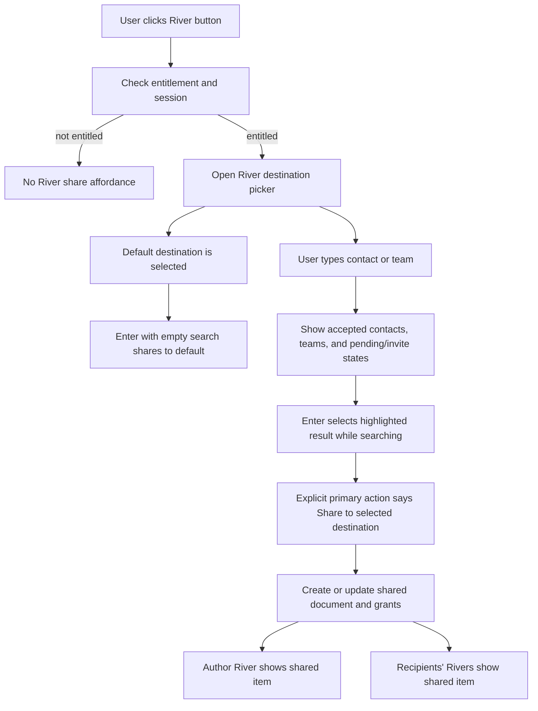
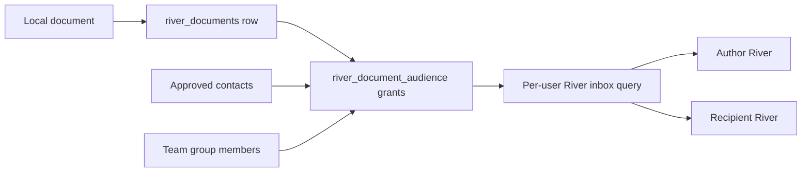
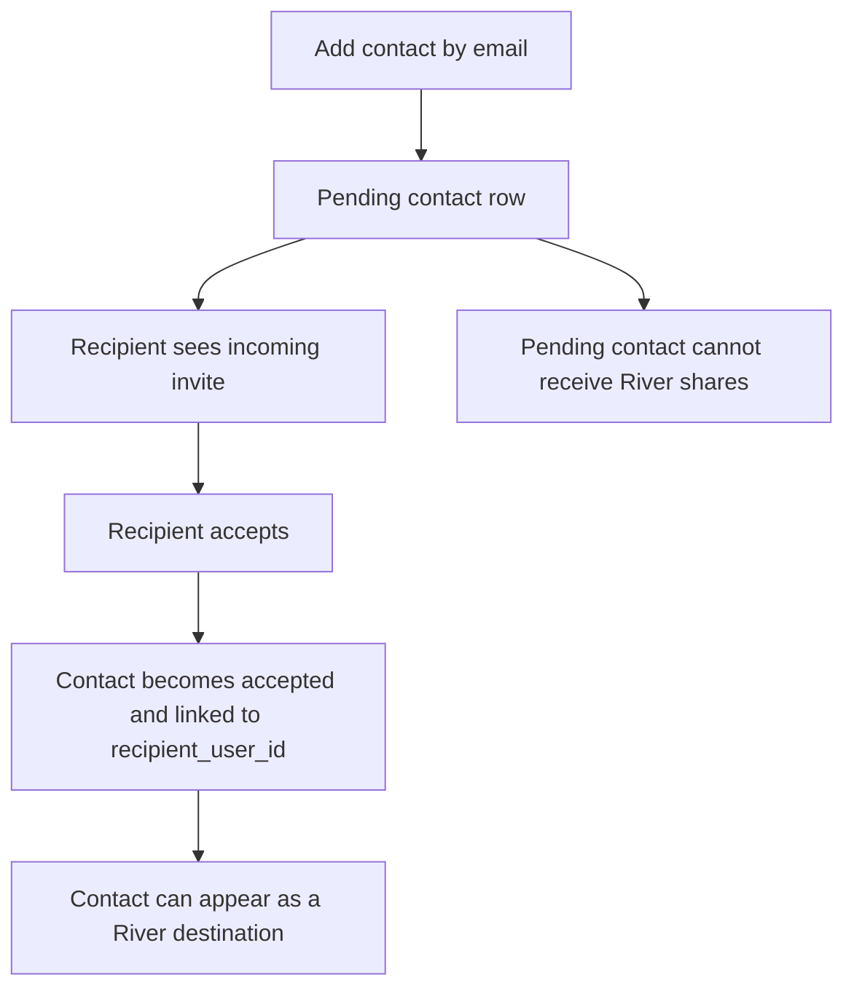

# feat: Add River share destinations

## Summary

Add a destination picker to River so a user can share one document to one approved contact, many approved contacts, or one team.
The first implementation should not introduce rooms.
A team is a named grouping of approved contacts, and River is the per-person inbox where received and authored shared documents appear.

The entitlement rollout remains the first gate.
Only entitled users should see or invoke this feature.
The new sharing model should replace the current single team scope assumption instead of stretching it.

## Current Reality

The current entitlement slice is the right launch gate, but the current River data model is not the right final shape for destinations.

- `shared_team_beta_users` controls whether Team and River surfaces are available.
- `SharedTeamService` can invite by email, accept invites, remove members, and leave a team.
- Current team state is derived from `contacts` rows with `relationship_type = 'team'` and `status = 'pending' | 'accepted'`.
- `SharedSyncService.shareFile()` writes one row into `team_documents` under a single `team_scope_user_id`.
- `SharedSyncService.syncOnce()` reads all River rows from that single `team_scope_user_id`.
- If more than one accepted team scope exists, `SharedTeamService.stateFromRows()` returns `ambiguous_team_scope`.
- `SettingsPanel` currently renders `TeamSettings` with `disabled`, so the service methods exist but the settings UI is not currently actionable.
- `socialSync.searchContacts()` exists, but it is too broad for River destinations because it does not enforce accepted status, team/contact eligibility, entitlement, or River writeability.

## Comfort Level

We are comfortable with the entitlement gate as the first rollout step.

We are comfortable with the existing invite and accept service as a base for approval mechanics.
It normalizes email, rejects self-invites, supports pending-to-accepted transitions, and can link email-only invites when the recipient later accepts.

We are not comfortable shipping the broader destination picker by reusing the current one-team River model.
That model was built around one shared document pool per team scope, and it already declares multiple scopes ambiguous.
The destination picker needs a document plus grants model.

We are also not comfortable using generic contact search directly for River.
River needs its own destination selector that returns only approved, writable destinations and exposes pending/invite states separately.

## Product Rules

- A user has one River.
- A document the author shares remains visible in the author's River.
- Sharing to one contact appears in that contact's River and the author's River.
- Sharing to many contacts appears in each selected contact's River and the author's River.
- Sharing to one team appears in every eligible accepted member's River and the author's River.
- Pending contacts are not share destinations.
- Email-only contacts are not share destinations until accepted by a real user account.
- Teams are named groups of approved contacts, not rooms.
- The picker should allow either one contact, many contacts, or one team.
- The picker should not allow team plus extra contacts in the first version.
- The author should see one apparent item in River, not a confusing duplicate beside the original document.
- Recipients should see one apparent item even if they are selected directly and also belong to a selected team.

## Destination Picker Flow



## Data Flow



## Invite And Approval Flow



## Data Model Direction

Use a canonical document plus grants model.

Recommended tables:

- `river_documents`
- `river_document_audience`
- `river_share_groups`
- `river_share_group_members`
- per-user River pins, likely keyed by `(user_id, document_id)`

The important rule is that the document has an owner and grants control who else can read it.

`river_documents` should use `(created_by, client_id)` as document identity so sharing the same source file to more destinations updates one shared document instead of creating duplicates.

`river_document_audience` should grant access by `recipient_user_id`, not by email.
Email is lookup metadata and should not be the access key.

The author must be readable through ownership:

```sql
created_by = auth.uid()
or exists (
  select 1
  from river_document_audience
  where document_id = river_documents.id
    and recipient_user_id = auth.uid()
    and revoked_at is null
)
```

Do not model the author only as another revocable grant.
If a revoke bug removes a self-grant, the author should still see their own shared document.

## Team Membership Semantics

Use snapshot membership for the first version.

When a user shares to a team, expand the team into its currently accepted members and write audience grants for those users.
If a new member joins the team later, they do not automatically get old shares in v1.
This is less magical and safer for privacy.

Dynamic team libraries can come later if we explicitly want old team shares to follow future membership changes.
That later version needs clearer audit logs, revocation UI, and wording.

## Requirements

- R1. Entitlement remains required before any River destination UI or IPC write path is available.
- R2. The River button opens a destination picker for unshared documents.
- R3. The picker preselects a default destination.
- R4. Pressing Enter shares to the default only when the search query is empty and the destination is clearly selected.
- R5. While searching, Enter selects the highlighted result rather than silently sharing to the old default.
- R6. The primary action text names the destination, such as `Share to Maya` or `Share to Design Team`.
- R7. Users can search accepted contacts and teams.
- R8. Search exposes pending or invite states without treating them as shareable destinations.
- R9. Users can share to exactly one contact, many contacts, or one team.
- R10. Users cannot combine a team plus extra contacts in v1.
- R11. A manually selected default destination can be changed from the picker.
- R12. If the saved default is no longer eligible, the picker falls back to no selection or the most recent valid destination and requires confirmation.
- R13. Sharing the same source file to new destinations updates one shared document and adds grants.
- R14. Recipients are deduped by `recipient_user_id`.
- R15. The author's River continues to show authored shared items.
- R16. Recipient Rivers show only documents granted to that user.
- R17. Pending contacts, non-accepted contacts, and unentitled users cannot be used as share destinations.
- R18. RLS enforces ownership and grants; renderer filtering is presentation only.
- R19. `team_documents.team_scope_user_id` stays as compatibility or migration source, not the new destination model.
- R20. The left-nav River shows more items by default or gains an in-place `Show more` control.

## Implementation Units

### U0. Decide the launch scope

Goal: choose whether today's release is entitlement-only, entitlement plus enabled Team settings, or entitlement plus the new destination picker.

Verify:

- The selected scope is written in release notes.
- The UI does not expose disabled controls as if they work.
- Manual Supabase setup is limited to the entitlement rows needed for the chosen team.

### U1. Add a destination selector contract

Goal: create a main-process API that returns River destinations with explicit states.

The contract should separate:

- accepted contact destination
- accepted team destination
- pending incoming invite
- pending outgoing invite
- invite-by-email candidate
- unavailable or unentitled state

Verify:

- Pending incoming invites can make River readable where current behavior needs it, but they do not become write destinations.
- Pending outgoing contacts do not appear as shareable contacts.
- Duplicate contact rows collapse to one stable destination by `recipient_user_id` first, then email only for pending display.
- The picker does not call `socialSync.searchContacts()` directly without River-specific filtering.

### U2. Make Team settings actionable or move approval into the picker

Goal: make contact invite and acceptance usable where users need it.

Current gotcha: `SettingsPanel` passes `disabled` to `TeamSettings`, so invite/accept/remove/leave may not be actionable from Settings even though service methods exist.

Verify:

- Entitled users can invite a contact from Team settings or from the destination picker.
- Incoming invites can be accepted from Team settings, and ideally from the picker when the user encounters the pending person.
- Non-entitled users cannot mutate contact/team state through hidden IPC.
- Accepting a second team does not strand the user in `ambiguous_team_scope`; either multiple teams are supported by destination identity or the UI blocks the accept with a clear message.

### U3. Add River document and audience tables

Goal: introduce the data model for one document with many explicit grants.

Verify:

- Author can read a shared document even with no active grants.
- Recipient can read a granted document.
- Non-recipient cannot read it.
- Pending contact cannot receive a grant.
- Recipient cannot grant themselves or others access.
- Revoked recipient loses access.
- Direct plus team grants dedupe to one visible River item.

### U4. Implement share-to-destination writes

Goal: update River sharing so a share writes or updates one canonical document, then writes grants for selected recipients.

Verify:

- Share to one contact creates one document and one recipient grant.
- Share to many contacts creates one document and one grant per recipient.
- Share to one team expands to accepted current members and creates grants.
- Author is not lost if all recipient grants are revoked.
- Same source file shared twice updates the same document via `(created_by, client_id)`.
- Sharing to a recipient already covered by a team does not create duplicate River items.

### U5. Implement recipient River sync

Goal: make River sync read documents visible to the signed-in user instead of one `team_scope_user_id`.

Verify:

- Author sees authored shared documents in River.
- Recipient sees granted documents in River.
- Revoked recipient cache files are removed or marked unavailable.
- Offline cache remains readable for previously synced items.
- Local filename collisions still key by shared document id, not title.

### U6. Build the destination picker UI

Goal: replace the one-click River add path with a fast picker.

Verify:

- Clicking River opens the picker.
- Default destination is visibly selected.
- Primary action names the selected destination.
- Enter shares only when safe.
- Search can find contacts and teams.
- Pending and invite states are visible but cannot be mistaken for completed shares.
- User can change the default destination from the picker.
- Offline, signed-out, unentitled, empty-search, no-default, and stale-default states have clear UI behavior.

### U7. Add River filtering and left-nav expansion

Goal: let the user keep River useful as more shared items arrive.

Verify:

- River can filter all contacts, selected contacts, selected teams, and authored-by-me.
- A noisy team can be excluded from the visible River without deleting shares.
- Left nav shows roughly double the current River count or provides in-place `Show more`.
- `Show more` expands the list in place rather than opening a separate menu.

### U8. Migrate or bridge existing team documents

Goal: preserve existing River data while moving away from `team_documents`.

Verify:

- Existing `team_documents` rows become `river_documents` plus audience grants, or the app has a temporary compatibility bridge.
- `revision`, `deleted_at`, `created_by`, `updated_by`, original source path, title, and content survive.
- Existing pins either migrate to per-user pins or the drop is explicitly documented.
- Existing local River cache remains readable across the migration.

## Outstanding Questions

1. What is the default destination: manually pinned, last used, most frequent, or current team?
2. For many contacts, do recipients know the other selected contacts, or is it a fan-out of separate one-to-one shares?
3. When the author shares the same document to a second destination later, does that add recipients or replace the old destination?
4. Does `Remove from River` remove all shares for the document or open a manage-destinations view?
5. Should the destination picker support invite-by-email in v1 or only show accepted contacts and existing teams?
6. Should recipients get notifications, or is River itself the notification?
7. Are teams private to the creator, or can a team have multiple managers?
8. Do team shares stay snapshot-based for v1, or do future team members inherit old team shares?

## Recommended Answers For V1

- Default destination: manually pinned, with last-used as the initial fallback.
- Many contacts: fan out to separate recipient grants and do not imply a room.
- Later share: add destinations to the same canonical document.
- Remove from River: for v1, author unshares the document from all recipients; manage-destinations can come next.
- Invite-by-email: show it in search, but make the user send/accept the invite before sharing.
- Notifications: skip push notifications for v1; River sync is the delivery mechanism.
- Teams: creator-owned groups of accepted contacts.
- Team shares: snapshot membership at share time.

## Risks And Gotchas

- The current team model treats multiple accepted scopes as ambiguous, which conflicts with multi-team destination search.
- Pending incoming invites currently expose an available team scope for readability; the picker must not treat that as writable.
- Generic contact search can return pending, friend, or email-only contacts that should not be River destinations.
- Duplicate contact rows can break `maybeSingle()` calls or create duplicate picker results.
- If default destination state goes stale, Enter could share to the wrong place unless the picker makes selection explicit.
- If author access is modeled only as a grant, revocation bugs can hide the author's own document.
- If team shares are dynamic from day one, removing someone from a team becomes a bulk historical revocation event.
- If many-contact sharing behaves like a hidden group, users may be surprised by recipient visibility.
- If Settings remains disabled, users cannot complete invite/accept flows from the place where the product says they should.

## Release Plan

1. Ship entitlement-only safely to the internal team.
   Verify that non-entitled users cannot see or invoke Team/River, and entitled users keep access offline.

2. Make Team invite/accept usable for entitled users.
   Verify Settings or picker approval flows work end to end for pending, accepted, declined, duplicate, and email-only invite cases.

3. Add the River destination model behind the entitlement gate.
   Verify RLS before wiring UI.

4. Add the destination picker with the default-destination fast path.
   Verify keyboard behavior and no accidental share paths.

5. Expand River visibility controls and left-nav capacity.
   Verify filtering keeps River useful after more people begin sharing.

## Sub-Agent Review Summary

Correctness review: build on `SharedTeamService` for team mechanics, but add a destination-specific API. Do not reuse broad `socialSync.searchContacts()` as the River destination source. Watch pending invites, duplicate contacts, second-team acceptance, and the currently disabled Team settings UI.

Data integrity review: do not extend `team_scope_user_id`. Use canonical shared documents plus recipient grants. Keep author ownership separate from recipient access. Deduplicate by `recipient_user_id`. Prefer snapshot team membership in v1.

Product review: the picker is right, but the selected destination must be impossible to miss. Enter behavior must distinguish empty default sharing from active search selection. Many-contact sharing needs explicit fan-out semantics so it does not accidentally become a hidden room.
