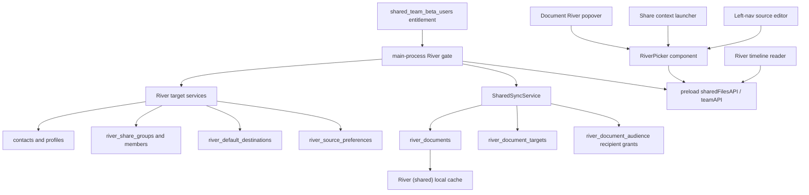
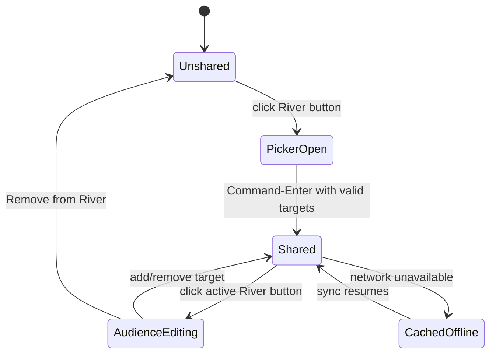

# feat: Build River timeline and picker

## Summary

Build River around one personal timeline and one reusable River Picker that selects groups, contacts, and public targets everywhere River needs a source or audience choice.
This plan migrates the current entitlement-gated team/contact implementation into a groups-and-contacts model while keeping old River cache behavior, old team rows, and offline readability intact.

---

## Problem Frame

The current River implementation has the right launch gate and the beginning of the right data model, but the product shape is still too close to "one team scope with one shared document pool."
The new design makes River a timeline of shared context and makes the selection primitive "where should this go?" rather than "which team is active?"

The design package is explicit on the core product move: River is one timeline, teams are just one kind of group, and selection should be one keyboard-first Picker reused in the reader, document popover, left-nav edit mode, and share launcher.
The current app already has entitlement, `river_documents`, recipient grants, local cache sync, pinned River items, toolbar affordances, and team invite/accept plumbing.
The plan should extend those pieces instead of replacing them wholesale.

---

## Requirements

**Access and Compatibility**

- R1. Entitlement through `shared_team_beta_users` remains required before River write controls, Team/River settings, or River IPC mutations are available.
- R2. Previously synced River cache files remain readable offline and do not disappear just because the network is unavailable.
- R3. Existing `contacts.relationship_type = 'team'` rows and migrated `team_documents` data keep working during the migration.
- R4. The old "ambiguous team scope" behavior is removed from the new River path because a user may belong to many groups.

**Audience Model**

- R5. A River item can be shared to one person, many people, one group, many groups, public, or any combination of those targets.
- R6. A team is represented as a group, not as the only River scope.
- R7. Audience editing is durable: reopening a shared document shows the current public/group/person targets and lets the author add or remove them.
- R8. Authors always see their own shared River items, even if every other target is removed.
- R9. Recipients only see private River items when an active materialized recipient grant gives them access; private group targets do not authorize reads by dynamic membership alone in v1.
- R10. Public River items are readable only under the intended authenticated/entitled public River policy, not by unauthenticated users.
- R10a. Users who join a group after a document was shared do not receive old private group items unless the owner explicitly reapplies or broadens that audience later.

**River Picker**

- R11. One River Picker component powers audience/source selection in the reader, document popover, share launcher, and left-nav edit mode.
- R12. The Picker supports group, person, and public rows with consistent labels, call-sign badges, avatars or initials, selected state, and default pills.
- R13. Default destinations are separate from current selection; all active defaults open pre-checked.
- R14. Typing filters rows and arms the top match; arrow keys move the armed row; Enter toggles the armed row; Command-Enter commits the checked rows.
- R15. Pending or unavailable contacts/groups may be visible for context but cannot be committed as share targets.

**Reader and Navigation**

- R16. River has a timeline reader with Private, Public, and disabled For You tabs.
- R17. River cards are title-first, show author/call-sign/group/time metadata, and support copy/open/bookmark/River actions.
- R18. Source filtering supports all/private, public, groups, people/contacts, mine, and selected sources without creating separate Rivers.
- R19. The left-nav River row still reads as the current shared-doc list by default, then flips into the River Picker source editor through the design's edit affordance.

**Sharing Flows**

- R20. Every River-eligible markdown document has the River button when the account is entitled, even before any destination is selected.
- R21. Unshared documents open the Picker with defaults pre-checked and an Add to River footer.
- R22. Shared documents open the Picker with current audience targets checked and a Remove from River footer that unshares the document entirely.
- R23. Unchecking one checked target removes only that target.
- R24. The Share context launcher is a two-step flow: choose a library file, then keep typing in the same launcher to choose River targets.
- R25. Pressing Command-Enter commits the selected targets; plain Enter toggles/selects during Picker selection.

**Groups, Contacts, and Consent**

- R26. Users can manage groups as named sets of contacts and can belong to many groups.
- R27. Contact and group membership changes require pending/accepted state unless the recipient has an explicit auto-approval preference.
- R28. Invite acceptance, decline, leave, and remove flows are available from the River/Groups settings surface.
- R29. Search results use contact/profile metadata, including call signs when available, but never grant access to unresolved email-only rows.
- R30. Source preferences can hide/mute sources from the default River view without deleting access.

---

## High-Level Technical Design



The target rows are the product-level audience: public, group, or person.
Materialized recipient grants are the private read authority for direct recipients and accepted group members in v1.
RLS should authorize by ownership, active recipient grant, or active public target under the intended entitlement policy.
During migration, active legacy recipient grants remain an access path until they can be represented by target-backed grants.



---

## Key Technical Decisions

- **Groups are the durable product primitive:** Use `river_share_groups` for named audiences, with existing team contact rows migrated or bridged into groups. The UI may still say team where appropriate, but the code path should not depend on one active team scope.
- **Keep entitlement as the first gate:** The broader River model does not replace the rollout safety boundary. Renderer visibility and main-process mutation paths must still check the existing entitlement service.
- **Add canonical target rows instead of overloading recipient grants:** `river_document_audience` currently requires `recipient_user_id`, so it cannot represent public or group targets cleanly. Add a target table for editable audience state, then maintain recipient grants for direct access, cache sync, and compatibility.
- **Keep v1 group access snapshot-based:** Sharing to a group materializes grants for currently accepted members. Future group membership changes do not automatically expose old private shares.
- **Use one Picker component across surfaces:** The current modal is embedded in `LibrarianView.tsx`. Extracting a reusable Picker first avoids duplicating keyboard behavior, target rendering, and default logic across reader, document, launcher, and nav.
- **Treat defaults as per-user target preferences:** Defaults are not a document audience. They seed the Picker on open and can include multiple targets.
- **Keep cache sync local-first:** The River reader may use richer metadata, but `River (shared)` remains the offline-readable cache and the sidebar source of existing River files.
- **Defer automated For You and `/goal` generation:** The schema and cards should leave room for future recommendations, but this plan ships the For You tab disabled and does not implement ambient goal creation.
- **Prefer additive migrations:** Existing records should be backfilled or bridged into the new target/group shape without deleting `team_documents`, `contacts`, or current River grant records.
- **Use one public target sentinel:** Store public audience rows with `target_kind = 'public'` and `target_id = 'public'` so target identity stays non-null and unique constraints remain simple.
- **Treat existing River grant tables as authoritative migration input:** `019_river_document_grants.sql` already migrates `team_documents` into `river_documents` and `river_document_audience`; this plan uses those River tables plus `contacts.relationship_type = 'team'` as the compatibility source for target/group backfill.

---

## Scope Boundaries

### Included

- River target/group/default/source-preference data model.
- Main-process River target, audience, and source APIs.
- Reusable River Picker component and design-token alignment.
- Document add/remove/edit-audience popover.
- Two-step Share context launcher.
- River reader timeline, basic source filters, and left-nav source edit mode.
- Group/contact invite and acceptance mechanics needed for the Picker and settings.

### Deferred to Follow-Up Work

- Automated For You ranking.
- Ambient `/goal` proposal generation.
- Public profile pages or a global social network surface.
- Full audit-log UI for every audience change.
- Rich notification delivery beyond visible pending invite state.

---

## Design Package Contract

The implementation should preserve these design states before the polish pass, not rediscover them at the end.

- **River Picker:** resting with defaults checked, filtering with armed top match, multiple defaults selected, pending-only rows disabled, no valid targets, stale default removed, offline target load failure, commit success, and commit error.
- **Document popover:** unshared Add to River, shared audience editing, per-target uncheck, Select all, full Remove from River with explicit destructive wording, loading, success, error, and undo or confirmation.
- **Share launcher:** file search, chosen-file pill, Picker expanded beneath the pill, target filtering after file selection, file swap, cancel, commit success, and commit failure.
- **Timeline reader:** default Private tab, Public tab, disabled For You tab, empty private timeline, empty public timeline, source drawer open/closed, card collapsed/expanded, and offline cached timeline.
- **Left nav:** normal River shared-doc list, source-edit affordance, inline Picker source editor, Done restore, Escape restore, empty groups/people, and overflow with many contacts.

---

## River Interaction Contract

The first River screen opens on the Private tab with the mixed private timeline ordered newest first.
Top-level tabs are Private, Public, and disabled For You.
Within Private, source filters compose as an include set: All private, Mine, Groups, People, and selected source rows from the source drawer.
Public ignores private source filters and shows public targets only.

The source drawer contains Public, Mine, Groups, People, Muted/Hidden, and pending invites.
Groups are shown before People; People can collapse because the list can grow.
The left-nav River edit affordance opens the same source rows inline under the River shortcut, persists changes as source preferences, Done commits the live preference state, and Escape restores the normal shared-doc list without changing the already-saved preferences.

Picker commits are disabled when no accepted targets are checked.
Stale defaults are dropped before render and explained inline.
Offline target loading keeps cached River readable but disables new commits.
Commit errors keep the Picker open with the selected targets intact.

The timeline API contract should include a typed query and item shape, exposed consistently through Electron IPC and browser-helper:

```ts
type RiverTimelineScope = 'private' | 'public';
type RiverSourceKind = 'all' | 'mine' | 'group' | 'person' | 'muted';

interface RiverTimelineQuery {
  scope: RiverTimelineScope;
  sourceIds: string[];
  limit: number;
  cursor?: string | null;
}

interface RiverTimelineItem {
  documentId: string;
  cachePath?: string;
  title: string;
  excerpt: string;
  authorCallsign?: string | null;
  authorInitials?: string | null;
  sourceLabel?: string | null;
  sourceKind: RiverSourceKind;
  sharedAt: string;
  pinned: boolean;
  public: boolean;
}
```

---

## System-Wide Impact

This change crosses the Supabase schema, RLS, main-process IPC, preload types, React reader UI, sidebar behavior, settings, and tests.
The main process remains the enforcement boundary for entitlement and write actions.
RLS remains the enforcement boundary for cross-user data exposure.
The renderer can filter, search, and present River state, but it must not be trusted to hide unauthorized data.

Because public River access is new, the migration must distinguish "public to entitled Field Theory users" from unauthenticated public web sharing.
That prevents accidental overlap with the separate `librarian:shareReading` public sharing surface.

---

## Acceptance Examples

- AE1. Given an entitled user with a default group, when they open an unshared markdown document and press the River button, then the Picker opens with that group checked and Command-Enter shares to that group.
- AE2. Given a document shared to a group and one person, when the author reopens the active River popover, then the group and person are checked and unchecking only the person removes only that direct target.
- AE3. Given a recipient with no network but a previously synced River cache, when they open the app, then the River cache remains visible and readable while remote writes are unavailable or stale.
- AE4. Given a user who belongs to two accepted groups, when they open River, then both groups are available as sources and destinations without an ambiguous team error.
- AE5. Given a pending group invite, when the invited user opens River/Groups settings, then they can accept or decline before the group becomes an active source or destination.
- AE6. Given an unentitled authenticated user, when they invoke hidden River IPC from the renderer, then the main process returns an unavailable result and no audience or document rows are written.
- AE7. Given a public River item, when an entitled authenticated user opens the Public tab, then the item appears; when an unauthenticated user queries River data, then RLS does not expose it.

---

## Implementation Units

### U1. Add River target, defaults, and source preference schema

**Goal:** Add the database structures needed to represent public, person, and group audiences without destroying the current recipient-grant model.

**Requirements:** R3, R5, R7, R8, R9, R10, R13, R18, R30.

**Dependencies:** None.

**Files:**

- `supabase/migrations/020_river_timeline_targets.sql`
- `mac-app/electron/main/supabaseMigrations.test.ts`

**Approach:** Add a `river_document_targets` table keyed by document, target kind, and target id.
Use target kinds for `person`, `group`, and `public`; public rows use the fixed target id `public`.
Add `river_default_destinations` for per-user defaults and `river_source_preferences` for include/mute/pin source controls.
Extend group membership schema for unresolved email invites, declined/revoked membership states, member leave, and auto-approval preferences.
Use `security definer` helper functions for entitlement, active target, accepted membership, target-backed grant visibility, and public visibility so RLS does not recurse through policy-protected tables.
Extend RLS so `river_documents` are visible to the owner, active target-backed recipient grants, and authenticated entitled users for active public targets.
Keep `river_document_audience` as the materialized recipient grant table for existing sync and direct recipient compatibility.
Backfill existing `river_document_audience.source_type = 'team'` grants into target rows where a legacy team/group can be inferred from migrated River data and team contacts; otherwise preserve the grant rows and let the compatibility service surface them as direct/private recipients.
Add explicit RLS for every new table: defaults and source preferences are per-user; target rows are owner-managed and readable only by owners or authorized viewers; group invite rows allow invitee accept/decline and member leave without allowing arbitrary member edits.

**Execution note:** Write migration tests before changing service code because this is the privacy boundary.

**Patterns to follow:** Follow the additive, idempotent shape in `supabase/migrations/019_river_document_grants.sql`.

**Test scenarios:**

- RLS allows document owner reads with no active targets.
- RLS allows a direct recipient through an active recipient grant.
- RLS allows an accepted group member through a materialized target-backed grant.
- RLS does not allow a pending group member through a group target alone.
- RLS allows `target_kind = 'public'` / `target_id = 'public'` rows only for the intended authenticated/entitled policy.
- Revoked target rows stop granting access.
- Existing `river_documents` and `river_document_audience` rows survive the migration.
- Migration tests catch policy recursion, including `infinite recursion detected in policy` failures.
- New target, default, source preference, group invite, and membership tables all have explicit RLS tests.

**Verification:** Migration tests assert the new tables, constraints, indexes, RLS policies, and legacy backfill statements are present.

### U2. Replace single-team state with River group/contact services

**Goal:** Introduce service contracts for groups, contacts, pending invites, profile metadata, defaults, and source preferences.

**Requirements:** R1, R4, R6, R11, R12, R13, R15, R26, R27, R28, R29, R30.

**Dependencies:** U1.

**Files:**

- `mac-app/electron/main/sharedTeamService.ts`
- `mac-app/electron/main/sharedTeamService.test.ts`
- `mac-app/electron/main/riverTargetService.ts`
- `mac-app/electron/main/riverTargetService.test.ts`
- `mac-app/electron/main/index.ts`
- `mac-app/electron/main/browserHelperServer.ts`
- `mac-app/electron/main/browserHelperServer.test.ts`
- `mac-app/src/types/window.d.ts`
- `mac-app/electron/preload.ts`
- `mac-app/src/browser-library.tsx`

**Approach:** Add a River-specific target service that reads accepted contacts, pending contacts, groups, pending group memberships, defaults, and source preferences.
Keep `SharedTeamService` as a compatibility wrapper for existing team settings while moving new APIs toward groups.
Map existing accepted team contacts into a default group-like destination so current users do not lose share targets.
Return target rows with stable ids, kind, label, detail, call sign, initials, avatar URL when available, tint, accepted/pending state, and default/source preference flags.
Expose IPC/preload methods for listing targets, setting defaults, creating/updating groups, inviting contacts or group members, responding to membership invites, and updating source preferences.
Expose the same target and settings operations through browser-helper only if the browser library needs them; otherwise return explicit unsupported responses so the old route shape does not silently diverge.

**Patterns to follow:** Match the defensive Supabase access style in `mac-app/electron/main/sharedTeamService.ts` and typed preload bridge style in `mac-app/electron/preload.ts`.

**Test scenarios:**

- Accepted contacts appear as person targets.
- Pending contacts appear as non-committable rows.
- Existing team contacts produce a group target without requiring one active team scope.
- Multiple groups do not return `ambiguous_team_scope`.
- Defaults are returned and ordered consistently.
- A stale or deleted default is omitted and does not pre-check an invalid target.
- Invite accept/decline updates pending membership state.
- Unentitled callers receive no writable target mutations.

**Verification:** Service tests prove target listing, default persistence, invite/accept flows, and legacy team bridging without renderer involvement.

### U3. Implement target-based share and audience editing

**Goal:** Make sharing write one canonical River document plus editable target rows and recipient grants.

**Requirements:** R1, R5, R7, R8, R9, R10, R20, R21, R22, R23.

**Dependencies:** U1, U2.

**Files:**

- `mac-app/electron/main/sharedSyncService.ts`
- `mac-app/electron/main/sharedSyncService.test.ts`
- `mac-app/electron/main/sharedFiles.ts`
- `mac-app/electron/main/index.ts`
- `mac-app/electron/main/browserHelperServer.ts`
- `mac-app/electron/main/browserHelperServer.test.ts`
- `mac-app/src/types/window.d.ts`
- `mac-app/electron/preload.ts`
- `mac-app/src/browser-library.tsx`

**Approach:** Extend `SharedSyncService.shareFile()` to accept target ids instead of only `contact` or `team`.
Resolve targets through the River target service, reject pending/unavailable targets, upsert one `river_documents` row, upsert active `river_document_targets`, and materialize direct/group recipient grants where needed.
Add an audience status API that returns the current target rows for a shared document.
Add an audience update API that diffs checked targets against existing targets, revokes removed targets, unrevokes or creates added targets, and updates recipient grants in one database transaction or RPC.
Private RLS should not allow a stale grant after its backing target is revoked, except for explicitly preserved legacy grants during migration.
Keep `unshareFile()` as the whole-document removal path.

**Execution note:** Characterize current `shareFile`, `getShareStatus`, `unshareFile`, and `syncOnce` behavior before changing target resolution.

**Patterns to follow:** Preserve `(created_by, client_id)` identity and cache writing behavior in `mac-app/electron/main/sharedSyncService.ts`.

**Test scenarios:**

- Covers AE1. Sharing to default group writes a document, group target, and accepted member grants.
- Sharing to one person writes a person target and one recipient grant.
- Sharing to many people and groups dedupes recipient grants.
- Sharing public writes a public target and does not require a fake recipient user.
- Re-sharing the same source file updates the same document.
- Audience status returns person/group/public target rows for an existing share.
- Removing one target revokes only that target.
- A stale active grant with its backing target revoked does not expose the document.
- Removing the final target keeps the author able to see the item until full unshare.
- Pending targets are rejected before database writes.
- Unentitled callers cannot write document, target, or grant rows.

**Verification:** `cd mac-app && npm run test:sync` passes with the new target scenarios.

### U4. Update River sync, cache metadata, and timeline query support

**Goal:** Keep local River cache behavior while adding enough metadata for timeline cards and source filtering.

**Requirements:** R2, R8, R9, R16, R17, R18, R30.

**Dependencies:** U1, U2, U3.

**Files:**

- `mac-app/electron/main/sharedSyncService.ts`
- `mac-app/electron/main/sharedSyncService.test.ts`
- `mac-app/electron/main/sharedFiles.ts`
- `mac-app/electron/main/index.ts`
- `mac-app/electron/main/browserHelperServer.ts`
- `mac-app/electron/main/browserHelperServer.test.ts`
- `mac-app/electron/shared/markdownFrontmatter.ts`
- `mac-app/electron/shared/markdownFrontmatter.test.ts`
- `mac-app/src/browser-library.tsx`
- `mac-app/src/components/WikiSidebar.tsx`
- `mac-app/src/components/__tests__/WikiSidebar.test.ts`

**Approach:** Extend sync reads so they load visible `river_documents` plus target/source metadata needed for author, group, public/private, and source filters.
Preserve `River (shared)` file writes and stale removal semantics.
Add or extend frontmatter fields for target/source metadata only where they help local rendering and do not become the source of authorization truth.
Add a main-process timeline query that can return card data directly from Supabase when online and from the local cache when offline.
Scope timeline cache metadata to the same signed-in user and entitlement state; after sign-out or user switch, raw files remain on disk but the app-level River timeline must not query another user's cache.
Add realtime publication/subscriptions or explicit post-mutation sync triggers for `river_document_targets`, `river_document_audience`, `river_share_group_members`, and public-target changes.
Keep sidebar pin behavior anchored by shared document id.

**Patterns to follow:** Follow current cache id, pin, stale removal, and presence patterns in `mac-app/electron/main/sharedSyncService.ts` and `mac-app/src/components/WikiSidebar.tsx`.

**Test scenarios:**

- Covers AE3. Previously synced cache files remain readable offline.
- Offline timeline queries only read cache metadata for the same signed-in user.
- Sync writes target/source metadata for newly visible documents.
- Revoked private access removes stale cache files on the next successful sync.
- Target, grant, membership, and public-target changes trigger sync or cache invalidation.
- Public items and private group items do not duplicate when the same user matches multiple sources.
- Sidebar River pins still prefer shared pin state over stale local pin state.
- Old cache files without new target metadata remain recognizable as River files.

**Verification:** Sync and sidebar tests prove old cache compatibility and new timeline metadata behavior.

### U5. Build the reusable River Picker component

**Goal:** Create the shared keyboard-first Picker and target row rendering specified by the design package.

**Requirements:** R11, R12, R13, R14, R15.

**Dependencies:** U2.

**Files:**

- `mac-app/src/components/RiverPicker.tsx`
- `mac-app/src/components/__tests__/RiverPicker.test.tsx`
- `mac-app/src/components/RiverTokens.ts`
- `mac-app/src/components/SidebarIcons.tsx`

**Approach:** Implement a controlled Picker that accepts targets, selected ids, default ids, surface mode, footer mode, and callbacks for toggle, commit, and default changes.
Render group circles, person avatars/initials, call-sign badges, public row, selected checkboxes, default pills, and disabled pending rows.
Use the current theme accent instead of hardcoding the design teal, while keeping the River token mapping in one place.
Support `palette`, `popover`, and `inline` surfaces with the same row component and keyboard behavior.
Apply the Picker state matrix from the River Interaction Contract in this component instead of leaving loading, empty, pending-only, stale-default, offline, and commit-error behavior to each caller.

**Patterns to follow:** Use existing local component/test style from `mac-app/src/components/ContentToolbar.tsx`, `mac-app/src/components/TeamSettings.tsx`, and their tests.

**Test scenarios:**

- Typing filters rows and arms the first visible match.
- Arrow keys move the armed row.
- Enter toggles the armed accepted row.
- Command-Enter commits all checked accepted rows.
- Pending rows render disabled and cannot be toggled.
- Default pills are visible and independent from selection.
- Multiple defaults open selected at once.
- Public, group, and person rows render the correct identity elements.
- Loading, empty, pending-only, stale-default, offline, and commit-error states render consistently across surfaces.

**Verification:** Component tests cover keyboard behavior, selection/default separation, and disabled states without needing `LibrarianView`.

### U6. Replace the document River modal with Picker-based audience editing

**Goal:** Make the toolbar River button edit a document's visibility instead of reposting.

**Requirements:** R7, R20, R21, R22, R23.

**Dependencies:** U3, U5.

**Files:**

- `mac-app/src/components/LibrarianView.tsx`
- `mac-app/src/components/ContentToolbar.tsx`
- `mac-app/src/components/__tests__/LibrarianView.test.tsx`
- `mac-app/src/components/__tests__/ContentToolbar.test.tsx`
- `mac-app/src/types/window.d.ts`

**Approach:** Remove the embedded one-off destination modal from `LibrarianView.tsx` and replace it with the shared Picker in popover mode.
When a document is unshared, seed selection from defaults and commit through the share API.
When a document is shared, load current target rows, seed selection from that audience, and commit through the audience update API.
Keep the active toolbar icon accent-colored for shared documents.
Use the remove footer only for whole-document unshare.
For whole-document unshare, use explicit destructive copy plus confirmation or an undo pattern; target-level unchecks remain immediate audience edits.
Keep hidden IPC protection and current entitlement visibility behavior.

**Patterns to follow:** Preserve the recent fix that shows the River button for entitled markdown documents before destinations exist.

**Test scenarios:**

- Covers AE1. Unshared markdown document opens Picker with defaults checked.
- Covers AE2. Shared document opens Picker with current audience checked.
- The River button is visible for entitled markdown documents even when target list is empty.
- The active River icon uses the accent when the document is shared.
- Unchecking one target calls audience update, not whole-document unshare.
- Remove from River calls full unshare.
- Full unshare has loading, success, error, and confirm-or-undo behavior.
- Empty/default-missing states are visible and do not crash.
- Unentitled users do not see the toolbar River button.

**Verification:** Focused `LibrarianView` tests cover the document flow without duplicating Picker keyboard tests.

### U7. Add the Share context launcher flow

**Goal:** Add the two-step composer flow that chooses a file, then expands the River Picker under the chosen file pill.

**Requirements:** R11, R13, R14, R24, R25.

**Dependencies:** U3, U5.

**Files:**

- `mac-app/src/components/RiverShareLauncher.tsx`
- `mac-app/src/components/__tests__/RiverShareLauncher.test.tsx`
- `mac-app/src/command-launcher.tsx`
- `mac-app/src/commandLauncherUtils.ts`
- `mac-app/src/__tests__/commandLauncherUtils.test.ts`
- `mac-app/src/components/LibrarianView.tsx`
- `mac-app/src/components/__tests__/LibrarianView.test.tsx`

**Approach:** Build the launcher as a small state machine: idle, picking file, picking River targets, committed.
Reuse existing library search/index data for step one rather than introducing a second file index.
After the file is chosen, lock it as a pill and pass the remaining query stream into River Picker filtering.
Commit through the same share API used by the document popover.
Wire the reader composer and Share context entry point to this launcher; the document toolbar River button remains owned by U6's document popover flow.

**Patterns to follow:** Follow current command launcher item filtering and keyboard conventions in `mac-app/src/command-launcher.tsx`.

**Test scenarios:**

- The launcher starts in file-pick mode from Share context.
- Enter on a file locks the file pill and opens Picker mode.
- Typing after file selection filters River targets, not files.
- Enter toggles the armed target in Picker mode.
- Command-Enter shares the chosen file to checked targets.
- Escape closes or backs out without committing.
- Swapping the file returns to file-pick mode without losing default target semantics.

**Verification:** Launcher tests cover the state machine and a `LibrarianView` integration test proves the composer can open it.

### U8. Build the River timeline reader and source filters

**Goal:** Turn River from a sidebar folder shortcut into a timeline reader with fast source filtering.

**Requirements:** R16, R17, R18, R30.

**Dependencies:** U2, U4, U5.

**Files:**

- `mac-app/src/components/RiverReader.tsx`
- `mac-app/src/components/__tests__/RiverReader.test.tsx`
- `mac-app/src/components/LibrarianView.tsx`
- `mac-app/src/components/WikiSidebar.tsx`
- `mac-app/src/components/__tests__/WikiSidebar.test.ts`
- `mac-app/src/types/window.d.ts`
- `mac-app/electron/preload.ts`
- `mac-app/electron/main/index.ts`
- `mac-app/electron/main/browserHelperServer.ts`
- `mac-app/electron/main/browserHelperServer.test.ts`
- `mac-app/electron/main/sharedSyncService.ts`
- `mac-app/src/browser-library.tsx`

**Approach:** Add a reader surface for the River shortcut that renders timeline cards from the timeline query/cache data.
Implement Private and Public tabs first and show For You disabled.
Add source filters for all/private, public, groups, people, mine, muted/hidden, and selected sources.
Wire the left-nav River edit affordance so the current shared-doc list flips into Picker-backed source editing and Done returns to the document list.
Make cards title-first with author/call-sign/group/time metadata and existing copy/open/bookmark/River actions.
Keep document opening behavior connected to the local cache file when available.

**Patterns to follow:** Preserve sidebar River promotion from `splitRiverShortcutNode()` and existing shared pin behavior in `WikiSidebar.tsx`.

**Test scenarios:**

- Covers AE4. Multiple groups appear as filterable sources without ambiguous state.
- The left-nav River edit affordance opens the Picker source editor and Done restores the shared-doc list.
- Private tab excludes public-only filtering when not selected.
- Public tab shows public River items.
- For You renders disabled and performs no ranking query.
- Mine filter shows authored shared items.
- Muted/hidden sources are excluded from the default view.
- Opening a card opens the cached document when present.
- Bookmark/pin action uses existing River pin APIs.

**Verification:** Reader tests prove filter behavior and sidebar tests prove the River shortcut still behaves like the current list by default.

### U9. Replace Team settings with Groups and Contacts settings

**Goal:** Give users a practical place to create groups, invite contacts, accept/decline memberships, and adjust approval preferences.

**Requirements:** R26, R27, R28, R29, R30.

**Dependencies:** U2, U5.

**Files:**

- `mac-app/src/components/TeamSettings.tsx`
- `mac-app/src/components/RiverGroupsSettings.tsx`
- `mac-app/src/components/__tests__/TeamSettings.test.tsx`
- `mac-app/src/components/__tests__/RiverGroupsSettings.test.tsx`
- `mac-app/src/utils/teamSettingsState.ts`
- `mac-app/src/__tests__/teamSettingsState.test.ts`
- `mac-app/src/components/SettingsPanel.tsx`
- `mac-app/electron/main/sharedTeamService.ts`
- `mac-app/electron/main/riverTargetService.ts`

**Approach:** Rename the product surface toward Groups/Contacts while preserving existing Team settings behavior for old team rows.
Show groups the user owns and groups they belong to.
Allow create/rename/delete group, invite contact/member by email, accept/decline incoming invites, remove members, leave groups, and set simple invite approval preferences.
Use the River Picker row vocabulary for group/person identity so settings and sharing feel connected.
Keep unentitled users locked out at renderer and IPC layers.

**Patterns to follow:** Keep the concise settings-row style from `TeamSettings.tsx` and `SettingsPrimitives.tsx`.

**Test scenarios:**

- Solo entitled user can create a group or invite a contact.
- Group owner can add/remove members.
- Incoming invitee can accept or decline.
- Member can leave a group.
- Auto-approval preference changes are persisted.
- Existing team contacts are displayed as a group-like Team without data loss.
- Disabled/unentitled mode locks all mutations.

**Verification:** Settings tests cover group/contact management and old Team settings tests are updated rather than deleted.

### U10. Polish visual states, accessibility, and release validation

**Goal:** Align the implementation with the supplied design states and verify the release-critical paths.

**Requirements:** R11, R12, R14, R15, R16, R17, R20, R21, R22, R24, R25.

**Dependencies:** U5, U6, U7, U8, U9.

**Files:**

- `mac-app/src/components/RiverPicker.tsx`
- `mac-app/src/components/RiverReader.tsx`
- `mac-app/src/components/RiverShareLauncher.tsx`
- `mac-app/src/components/LibrarianView.tsx`
- `mac-app/src/components/WikiSidebar.tsx`
- `mac-app/src/components/__tests__/RiverPicker.test.tsx`
- `mac-app/src/components/__tests__/RiverReader.test.tsx`
- `mac-app/src/components/__tests__/RiverShareLauncher.test.tsx`
- `mac-app/src/components/__tests__/LibrarianView.test.tsx`

**Approach:** Audit the Picker, reader, document popover, share launcher, and left-nav edit mode against the final system design.
Use the app accent token for River selected states, default pills, active icon, and keyboard chips.
Ensure `listbox`/`option` roles, `aria-selected`, disabled pending rows, full-row hit targets, reduced-motion behavior, and contrast.
Add per-surface accessibility checks for tab semantics, source-filter keyboard behavior, launcher combobox state, popover focus return, card action navigation, and left-nav edit mode.
Add empty states for no contacts, no groups, no defaults, pending-only, offline stale, and unentitled gates.

**Patterns to follow:** Follow the design package's final system states while using the app's existing theme variables and component conventions.

**Test scenarios:**

- Picker roles and selected states are accessible.
- Keyboard and mouse selection produce the same checked targets.
- Empty target states explain what action is available.
- Offline stale state leaves cached River readable.
- Narrow windows keep Picker and reader content within bounds.
- Design-critical text does not overflow compact buttons or rows.

**Verification:** Run focused Vitest suites for River components, sync, sidebar, settings, and a production build/typecheck before release.

---

## Risks & Dependencies

- **RLS public-target risk:** Public River is not the same as public web sharing. The migration must encode the intended entitlement/auth policy, and tests must make unauthenticated exposure fail.
- **Compatibility risk:** Existing users have `contacts.relationship_type = 'team'`, `team_documents`, and local River cache files. The migration must be additive and old cache metadata must remain readable.
- **Large component risk:** `LibrarianView.tsx` already owns many behaviors. Extracting River Picker and launcher components before adding states reduces regression risk.
- **Offline behavior risk:** Cache readability and remote write availability are separate states. The UI must not remove cached content when sync or entitlement lookup is temporarily stale.
- **Terminology drift:** The product language should move to Groups/Contacts/River without breaking code that still has `SharedTeamService` compatibility responsibilities.

---

## Documentation / Operational Notes

- Supabase rollout should run the new migration manually or through the existing migration path before enabling the UI release.
- Release notes should say River is moving from beta Teams to a timeline with groups, contacts, public targets, defaults, and editable document visibility.
- Manual QA should include one owner, one accepted contact, one pending contact, one group with multiple accepted members, one public item, and one offline launch after a successful sync.

---

## Sources / Research

- Design package files: `River - Implementation Guide.md`, `River - Final System.dc.html`, `River Flow.dc.html`, `River Palette.dc.html`, `River Share v6.dc.html`, and `River Directions.dc.html`.
- Prior product brief: `docs/plans/2026-06-19-001-river-timeline-product-brief.md`.
- Entitlement plan: `docs/plans/2026-06-17-001-feat-team-river-entitlement-plan.md`.
- Share-destinations plan: `docs/plans/2026-06-18-001-feat-river-share-destinations-plan.md`.
- Current schema baseline: `supabase/migrations/019_river_document_grants.sql`.
- Current main-process sharing code: `mac-app/electron/main/sharedSyncService.ts`, `mac-app/electron/main/sharedTeamService.ts`, and `mac-app/electron/main/index.ts`.
- Current renderer surfaces: `mac-app/src/components/LibrarianView.tsx`, `mac-app/src/components/ContentToolbar.tsx`, `mac-app/src/components/WikiSidebar.tsx`, and `mac-app/src/components/TeamSettings.tsx`.
- No relevant `docs/solutions/` River entries were present in this checkout.
