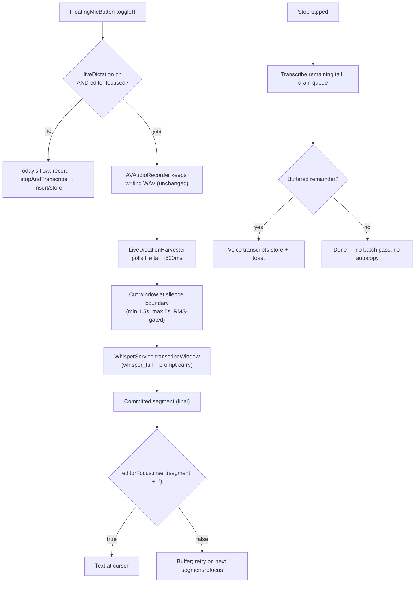

# feat: iOS live dictation — stream transcript into the focused editor while speaking

> **Implementation repo:** `/Users/afar/dev/fieldtheory` (branch `ios-native-app`), app source under `ios-native/FieldTheory/`. This plan doc lives in the OSS repo's plans directory; all file anchors below are relative to `ios-native/FieldTheory/Sources/` unless stated. Anchors were verified 2026-07-02; anchor by symbol name first, line numbers may drift.

## Summary

Add an opt-in **Live dictation** setting to the iOS app: while the user records with the floating mic and the markdown editor is focused, transcribed text is inserted at the cursor **as they speak** (committed segment by segment, every ~2–4s) instead of arriving once when recording stops. The existing stop-then-insert flow remains the default and is untouched when the toggle is off.

Scope is **in-app only** (user decision 2026-07-02): text streams into Field Theory's own editor. iOS offers no way to type into other apps' fields from an app; a custom keyboard extension is the only system-wide path and is explicitly deferred.

This is the iOS sibling of the mac plan (`mac-app/docs/PLAN_LIVE_TYPING.md`) and inherits its core contract: **the field only ever receives committed, final text — append-only, never revised**. Interim hypotheses are never externalized.

## Current Reality

- **Recording:** `AVAudioRecorder` writes 16 kHz mono Linear-PCM WAV segments (`Voice/RecorderController.swift:107-123`, `startNewSegment()`).
- **Transcription is batch-only:** on stop, `stopAndTranscribe()` (`RecorderController.swift:163-199`) slices audio into 10-minute chunks and runs each through `WhisperService.transcribe()` (`Voice/WhisperService.swift:33-81`), which calls `whisper_full()` on the entire slice. whisper.cpp is linked as a Metal-accelerated xcframework (`ios-native/project.yml:52-54`, built by `ios-native/scripts/build-whisper-ios.sh` with `GGML_METAL=ON`). No `SFSpeechRecognizer`, no partial results, no streaming anywhere.
- **Routing:** the final transcript flows through `onTranscript` (`App/RootView.swift:109-126`): if the editor is focused, `editorFocus.insert(text)` inserts at the cursor; otherwise the text is saved to the Voice transcripts store. `EditorFocusBus` (`Library/MarkdownEditor.swift:8-17`) holds `isEditing` + an `insertHandler` that calls `UITextView.insertText` (wired at `MarkdownEditor.swift:206-218`).
- **Mic UI:** `DraggableMicOverlay` / `FloatingMicButton` (`App/RootView.swift:129-236`) toggles `model.recorder.toggle()`; position persists via `AppSettings.micPositionFraction`.
- **Settings pattern:** `AppSettings` properties with `didSet → UserDefaults` (e.g. `autoCopyTranscripts`, key `"voice-auto-copy"`, `Settings/AppSettings.swift:50-53`), bound in `Settings/SettingsView.swift:73-76`, consumed in `RootView.swift:117-119`.
- **Tests:** `FieldTheoryTests` and `FieldTheoryUITests` targets exist (`ios-native/project.yml:14-43`).

## Requirements

**Behavior**
- R1. With the setting on and the markdown editor focused when recording starts, committed transcript segments are inserted at the cursor while recording continues.
- R2. Committed text is final: no already-inserted text is ever modified or deleted by the feature (append-only).
- R3. With the setting off, behavior is byte-identical to today (regression-tested).
- R4. If the editor is not focused when recording starts, the session runs exactly as today (batch), regardless of the toggle.
- R5. If the editor loses focus mid-session, segments buffer; they flush if the same editor regains focus; anything unflushed at stop is saved to the Voice transcripts store (the existing fallback destination) with a toast saying so.
- R6. Segment text inserted live must concatenate to the same transcript the batch path would have produced from the same windows (single-space joined, trailing space after each segment).
- R7. Live sessions skip `autoCopyTranscripts` (nothing should silently overwrite the pasteboard after text already landed in the editor).
- R8. Silent windows must not produce insertions (whisper hallucinates on silence; RMS-gate before transcribing).

**Quality/safety**
- R9. Transcription must stay fully on-device (whisper.cpp), matching the app's offline philosophy — no `SFSpeechRecognizer`.
- R10. Live windows should carry context: each window's transcription is prompted with the tail of previously committed text to reduce boundary errors.
- R11. Recording and batch fallback must never be corrupted by the live reader: the harvester only ever *reads* the growing WAV; the full recording remains intact for the existing stop-time slicing if live mode aborts.

## High-Level Design

## Key Technical Decisions

- **Windowed batch over the growing file, not a new audio stack.** `AVAudioRecorder` already writes Linear-PCM WAV continuously. The harvester opens the same file read-only, skips the 44-byte header, and reads *appended PCM bytes* by offset — it must track its own byte offset and never trust the WAV header's length field (the header is finalized only at stop). This leaves the recording pipeline untouched (R11). An `AVAudioEngine` tap is the fallback approach only if file-tail reads prove unreliable on-device.
- **Silence-gated windows.** Cut a window when ≥1.5s of new audio exists AND the trailing ~300ms RMS is below a speech threshold, or at a 5s hard cap. Windows whose overall RMS is below the threshold are dropped without transcription (R8). This approximates the mac helper's word-boundary "dictation" harvest mode.
- **`whisper_full` per window with prompt carry (R10).** Add a window-transcribe entry point to `WhisperService` that accepts PCM floats plus an `initialPrompt` string (last ~200 chars of committed text) via `whisper_full_params.initial_prompt`. Suppress non-speech tokens. Serial queue — one window in flight, strictly FIFO.
- **Append-only commit (R2), identical to the mac contract.** A segment is inserted once, with a trailing space, and never touched again. No interim display, no revision. The editor is app-owned, so revision *would* be technically possible — it is still rejected for v1 to keep the contract and the code simple; revisit only with real usage feedback.
- **The session is decided at record-start (R1/R4).** Eligibility = toggle on AND `EditorFocusBus.isEditing` true at `toggle()` time. Mid-session focus loss buffers rather than re-deciding (R5).
- **Stop-time behavior replaces the batch pass.** In a live session, stop means: cut and transcribe the final tail window, drain the queue, attempt one buffer flush, then route any remainder to the transcripts store. The 10-minute-slice batch path does not run (the live transcript IS the result). If the live session aborted early (harvester error), fall back to the full batch path — the WAV is intact (R11).

## Implementation Units

### U1. `LiveDictationHarvester` — window cutter over a growing WAV

**Goal:** A testable component that turns a growing WAV file into an ordered stream of RMS-gated PCM windows.

**Requirements:** R8, R11.

**Files:** `Voice/LiveDictationHarvester.swift` (new), `FieldTheory/Tests/LiveDictationHarvesterTests.swift` (new).

**Approach:** Poll every ~500ms (async task, not a timer on the main actor). Maintain `consumedByteOffset` starting at 44 (header). Read `fileSize - consumedByteOffset` new bytes; convert to Float32 PCM (16 kHz mono, matching `startNewSegment()`'s format — verify the recorder's actual sample format: if it records Int16 PCM, convert; keep one conversion function with a unit test). Apply the cut rules from Key Technical Decisions. Emit `(windowIndex, [Float])` via an `AsyncStream` or delegate callback. `finishAndCutTail()` flushes whatever remains as the final window. Never write to the file; never seek the recorder.

**Test scenarios:** synthetic WAV fixtures — appended writes produce windows in order; silence-only region emits no window; window boundaries respect min/hard-cap; tail flush emits the remainder; header length field being stale (zero) does not matter; offset survives a poll that observes no growth.

**Verification:** unit tests pass in `FieldTheoryTests`; no API of `RecorderController` is modified by this unit.

### U2. `WhisperService.transcribeWindow(pcm:initialPrompt:)`

**Goal:** Window-sized transcription with context carry, reusing the loaded whisper context.

**Requirements:** R9, R10.

**Files:** `Voice/WhisperService.swift` (extend; current batch entry at `:33-81`).

**Approach:** New method taking `[Float]` PCM + optional prompt string; set `initial_prompt` on `whisper_full_params`, enable non-speech suppression, reuse the existing context/model instance behind a serial queue so live windows and any batch call never run concurrently. Return trimmed segment text.

**Test scenarios:** if a test-size model is available in CI use a short fixture clip; otherwise gate with a manual-QA note. At minimum, unit-test the parameter plumbing (prompt set, empty PCM returns empty string without calling whisper).

**Verification:** existing batch `transcribe()` behavior unchanged (existing tests still pass).

### U3. Live session coordinator + routing integration

**Goal:** Wire harvester → whisper → editor insertion with the buffering and stop semantics.

**Requirements:** R1, R2, R4, R5, R6, R7, R11.

**Files:** `Voice/RecorderController.swift` (session start/stop hooks), `App/RootView.swift` (wiring, `:109-126` region), `Voice/LiveDictationSession.swift` (new: owns harvester + queue + buffer), `FieldTheory/Tests/LiveDictationSessionTests.swift` (new).

**Approach:** On `toggle()` start: if eligible (U4 setting + `editorFocus.isEditing`), create a `LiveDictationSession` bound to the current recording file URL and an `insert: (String) -> Bool` closure (wraps `editorFocus.insert`). Session rules: strictly serial — window N's text inserts before window N+1's is attempted; each insert is `segment + " "`; on `insert(...) == false`, push to buffer and retry buffer head before each subsequent insert attempt (covers refocus, R5). On stop: `finishAndCutTail()`, drain, final flush attempt, then: remainder → `model.transcripts.add(text:)` + toast "Saved to Voice"; skip the batch `stopAndTranscribe()` transcription for this segment's audio; skip `autoCopyTranscripts` (R7). On any harvester/whisper error mid-session: cancel the session, let the normal stop path run the full batch flow (R11) — the user gets today's behavior, minus any duplicate insertion of already-committed segments: track committed text and pass it to the batch path to strip an already-inserted prefix before routing (prefix match on the joined committed string; if the batch transcript does not start with the committed prefix, route the *entire* batch transcript to the transcripts store instead of the editor — never double-insert).

**Patterns to follow:** the `onTranscript` routing style in `RootView.swift:109-126`; toast usage as in `DocumentView.shareToRiver()`.

**Test scenarios:** ordered insertion; buffering on refused insert and flush on next success; remainder routed to store at stop; error mid-session falls back to batch with committed-prefix stripping; batch-transcript-mismatch routes to store, never double-inserts; setting-off and editor-unfocused sessions never construct a session (R3/R4).

**Verification:** all new tests green; recording a session with the toggle **off** produces today's exact flow (assert no `LiveDictationSession` is created).

### U4. Setting + UI

**Goal:** Opt-in toggle following the house settings pattern.

**Requirements:** R1, R3.

**Files:** `Settings/AppSettings.swift` (property `liveDictation`, UserDefaults key `"voice-live-dictation"`, default `false`; pattern at `:50-53`), `Settings/SettingsView.swift` (Toggle near the transcription settings, pattern at `:73-76`).

**Copy:** "Live dictation (experimental)" — "While recording with a document open for editing, words appear at your cursor as you speak. The transcript is committed as spoken — auto-copy and post-processing are skipped for live sessions."

**Test scenarios:** default off; persists across relaunch (UserDefaults round-trip).

**Verification:** toggle renders and binds; `xcodegen` build clean.

### U5. Manual QA + docs

**Goal:** Device validation checklist (simulator whisper-Metal behavior differs from device).

**Checklist:** dictate into a doc with cursor mid-paragraph (text lands at cursor, spacing correct); pause 5s mid-dictation (no hallucinated text, R8); dismiss keyboard mid-dictation then refocus (buffered text flushes, R5); stop while unfocused (remainder in Voice tab + toast); toggle off regression; long dictation (~3 min) for thermals/latency feel; airplane mode (everything works, R9); low-storage/very short (<1.5s) recordings.

**Verification:** checklist executed on a physical device before merge.

## Scope Boundaries

**In scope:** everything above.

**Deferred:** custom keyboard extension (system-wide dictation into other apps — the only iOS mechanism; large, separate plan); interim-hypothesis display or revision of inserted text; live dictation into fields other than the markdown editor (e.g. search fields); tuning UI for window sizes; using the mac plan's LLM auto-improve on iOS (doesn't exist on iOS today).

**Outside:** replacing whisper.cpp, adding `SFSpeechRecognizer`, changing the batch pipeline's 10-minute slicing, mac-app changes.

## Risks & Dependencies

- **Whisper on short windows loses context** → mitigated by prompt carry (R10) but boundary artifacts (split words) will occasionally occur; the append-only contract accepts this (same tradeoff the user accepted on mac).
- **Hallucination on near-silence** is whisper's classic failure → RMS gating both at cut time and window-drop time (R8) is load-bearing; tune thresholds on device.
- **File-tail reading assumptions** — `AVAudioRecorder` + Linear PCM appends frames linearly, but if a settings change ever moves recording to AAC, the harvester must refuse to start (guard on the recorder's format) and fall back to batch.
- **Thermals/battery:** Metal inference every ~2-4s during dictation; acceptable for dictation-length sessions but the QA long-session check is required.
- **Editor focus churn** (SwiftUI rebuilds) could make `insert` transiently fail → the buffer-and-retry design absorbs this.

## Sources & Research

- `Voice/RecorderController.swift:107-123, 163-199` — recording format and batch flow.
- `Voice/WhisperService.swift:33-81` — `whisper_full` batch usage.
- `App/RootView.swift:109-126, 129-236` — transcript routing and floating mic.
- `Library/MarkdownEditor.swift:8-17, 206-218` — `EditorFocusBus` insert path.
- `Settings/AppSettings.swift:50-53`, `Settings/SettingsView.swift:73-76` — settings pattern.
- `ios-native/project.yml:14-43, 52-54` — test targets, whisper xcframework.
- `mac-app/docs/PLAN_LIVE_TYPING.md` — sibling plan; shared commit-horizon contract.
- whisper.cpp `initial_prompt` / non-speech suppression: standard `whisper_full_params` fields (see whisper.h in the vendored tree).
