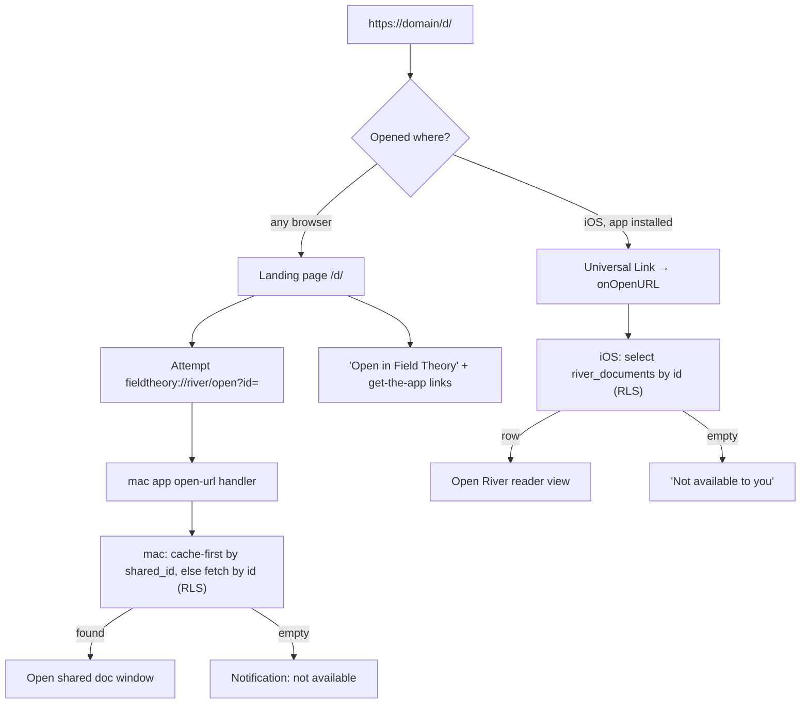

# feat: Team share links — copy a link to a doc that opens in the mac or iOS app

> **Implementation repos:** mac + web + SQL in `/Users/afar/dev/fieldtheory-oss`; iOS in `/Users/afar/dev/fieldtheory` (branch `ios-native-app`, source under `ios-native/FieldTheory/Sources/`). Anchors verified 2026-07-02; anchor by symbol first.

## Summary

Add a **Copy link** affordance to the document toolbar on mac and to the document menu on iOS. The copied link is an HTTPS URL (`https://<link-domain>/d/<river-document-uuid>`) that, when opened by a teammate, opens that document **in the Field Theory mac app** (via a landing page that hops to the existing `fieldtheory://` protocol) or **in the iOS app** (via a Universal Link). Access is enforced by the existing River grants: the link is an *address, not a capability* — forwarding it to someone without a grant hands them nothing, and revoking access is an audience-row change, not a link rotation.

User decisions (2026-07-02): HTTPS universal link format; **share-then-copy** semantics (copying a link for a not-yet-shared doc first shares it to the default team destination, behind a lightweight confirm, then copies).

**No new database tables or RLS policies are required.** Migration 019 already provides everything: `river_documents.id` as the stable identity, `river_document_audience` as the grant table, and a select policy ("visible to owner or active recipient", `019_river_document_grants.sql:105-117`) that *is* the link-resolution rule.

## Current Reality

- **Identity:** a shared doc is a `river_documents` row (uuid `id`, dedup on `(created_by, client_id)` — `supabase/migrations/019_river_document_grants.sql:4-38`). The mac app stores this uuid in local frontmatter as `shared_id` (`mac-app/electron/main/sharedFiles.ts:276`) and reads/writes the new model throughout `sharedSyncService.ts` (`river_documents` at `:713, :880, :1067…`; `river_document_audience` at `:904, :956…`; legacy `team_documents` dual-reads remain at `:738, :1194, :1327`).
- **Grants:** `river_document_audience(document_id, recipient_user_id, source_type 'direct'|'team', source_id, revoked_at)`; team shares fan out one row per accepted member (backfill shape at `019:297-331`).
- **Critical unification:** the 019 backfill copies `team_documents.id` **as** `river_documents.id` (`019:255-295`), so legacy and new document ids are the same uuid.
- **iOS is still on the legacy model:** `SyncEngine` reads/writes only `team_documents` (`Core/SyncEngine.swift:451, :547`), sharing via `shareToRiver(sourcePath:content:)` (`:497-573`) with `client_id = "shared-" + sha256(userId + ":" + sourcePath).prefix(32)` (`:555`); team scope resolved from `contacts` (`:406-445`). River inbox cache: `Core/RiverStore.swift`.
- **mac deep links exist:** custom scheme `fieldtheory` (`mac-app/electron/main/urlProtocolRegistration.ts:3`), routes parsed in `fieldTheoryProtocolTarget.ts` (`browser-library/open`, `library/open`, `commands/open`, `bookmarks/open`), dispatched from `app.on('open-url', …)` (`mac-app/electron/main/index.ts:15566-15568`).
- **iOS has no URL handling at all:** no `CFBundleURLTypes`, no Associated Domains entitlement, no `onOpenURL` (`ios-native/FieldTheory/Resources/Info.plist`; simulator-only launch directives at `App/AppModel.swift:104-110`).
- **Toolbars:** mac `ContentToolbar.tsx` has a `ToolbarActionId` union + pinned-order list ('copypath', 'share' via `RiverShareLauncher`, etc.); iOS `Library/DocumentView.swift:75-153` has a copy button and an ellipsis `Menu` containing "Share to River" (`shareToRiver()` at `:142-153`, with in-flight state + toast).
- **Gates:** Teams/River sit behind the `shared_team_beta_users` entitlement on mac (`sharedTeamEntitlementService.ts`); iOS does not check it yet. Auth: Supabase session (mac: `authManager.ts`; iOS: OTP via `Core/AuthStore.swift`).
- **No web surface exists** (no landing page, no AASA file). The team controls `fieldtheory.dev` (dev subdomain `librarian.fieldtheory.dev` appears in browser-helper tests).

## Product Rules

- A link addresses a document; it never grants access. Whoever opens it must be signed in and hold a non-revoked audience grant (or be the creator). RLS is the enforcement point — the client never decides.
- "No access" and "does not exist" are deliberately indistinguishable (RLS returns nothing for both). The UI shows one neutral message: "This document isn't available to you."
- Copy link on an already-shared doc copies immediately (toast). On a private doc it shows one lightweight confirm ("Share to <team> and copy link?"), shares to the default destination, then copies. Sharing is never a silent side effect.
- The default destination is the user's current team scope; with no team and no destination, Copy link routes into the existing share destination picker first (mac) or shows "Join a team to share" (iOS, which has no picker yet).
- The copied artifact is always the HTTPS URL. `fieldtheory://` remains an internal hop (landing page → mac app), never the thing users paste.
- Links are stable for the life of the shared doc: same doc → same uuid → same URL, on every platform (guaranteed by `(created_by, client_id)` dedup + the 019 id unification).
- Both features stay behind the `shared_team_beta_users` entitlement on both platforms.

## Link Anatomy & Open Flow

`https://<link-domain>/d/<uuid>` — optionally `https://<link-domain>/d/<uuid>/<title-slug>` where the slug is cosmetic and ignored by all resolvers. `<link-domain>` is an ops choice at implementation time (suggestion: `go.fieldtheory.dev`); it appears in exactly one constant per platform plus the web deploy.

Copy flow: toolbar action → ensure shared (share-then-copy w/ confirm when needed) → obtain `river_documents.id` → build URL → clipboard + toast.

## Key Technical Decisions

- **Address, not capability.** No secret tokens in URLs, no "anyone with the link" tier in v1. Leakage through chat logs/history is harmless; revocation reuses the existing audience-revoke path. A public-link tier can come later via `river_document_targets` `target_kind='public'` (migration 020) without changing the URL shape.
- **Resolution is just an RLS-scoped select.** Both clients resolve a link by `select … from river_documents where id = <uuid>` with the user's session. No edge function, no new endpoint.
- **mac opens via landing-page → custom scheme, not Associated Domains.** Registering `applinks:` for a Developer-ID Electron app needs provisioning-profile gymnastics; the landing-page hop costs one browser flash and works today. Native mac universal links are deferred.
- **iOS adopts the new model per-document, not wholesale.** Copy link on iOS performs the legacy share (unchanged, keeps parity with today's River inbox) **and then mirrors the 019 backfill for that one doc**: upsert `river_documents` with `id = <team_documents.id>` + upsert team audience rows (`019:297-331` shape). Ids stay unified; the mac app sees nothing new; full iOS migration to the new sync model stays a separate effort.
- **The web surface is a static site** — an `apple-app-site-association` file and one HTML page. No server code, no doc metadata on the page (it can't have any: resolution requires auth; the page stays generic by design).
- **Entitlement gates both ends on both platforms.** Copy link and link-open check `shared_team_beta_users` (mac: existing resolver; iOS: new one-row read). A granted-but-unentitled user gets the neutral unavailable message — acceptable during the beta gate, noted as a rollout constraint.

## Implementation Units

### U1. mac — Copy link service + toolbar button

**Goal:** `Copy link` in the doc toolbar that returns a URL, sharing first when needed.

**Files:** `mac-app/electron/main/sharedSyncService.ts` (+test) — `getShareLink(filePath)`: read local shared status/frontmatter; if `sharedId` exists → build URL; else return `needs_share` so the renderer can run the confirm+share flow first. `mac-app/electron/main/index.ts` — `ipcMain.handle('sharedFiles:getShareLink', …)` behind the existing entitlement + auth guards (match the `sharedFiles:*` guard shape). `mac-app/electron/preload.ts` — expose on `sharedFilesAPI`. `mac-app/src/components/ContentToolbar.tsx` (+test) — new `ToolbarActionId` `'copylink'` (icon: link), placed adjacent to `'share'` in `PINNED_TOOLBAR_ACTION_ORDER`; on click: `getShareLink` → if `needs_share`, open the existing `RiverShareLauncher` with the default team destination preselected and a "Share and copy link" primary action; on success write URL to clipboard + toast "Link copied". Put the link-domain constant in one shared module (e.g. `mac-app/electron/shared/shareLinks.ts` with `buildShareUrl(id)`/`parseShareUrl(url)` + tests) so main, renderer, and tests agree.

**Test scenarios:** already-shared doc → URL immediately, no share writes; unshared doc → share-then-copy path invoked once, URL contains the new `shared_id`; unentitled/signed-out → action hidden (follow the `sharedFilesAvailable && (sharedFilesCanWrite || sharedFileStatus.shared)` visibility pattern from the entitlement plan U4); URL format round-trips through `parseShareUrl`.

**Verification:** unit tests green; manual: button copies a working URL for a shared doc.

### U2. mac — `fieldtheory://river/open?id=<uuid>` route

**Goal:** The mac app opens a granted shared doc from the scheme URL.

**Files:** `mac-app/electron/main/fieldTheoryProtocolTarget.ts` (+test) — parse the new host/path (`river/open`, param `id`, validate uuid). `mac-app/electron/main/index.ts` — route dispatch next to the existing `open-url` handling (`:15566-15568`); confirm the handler queues URLs arriving before app-ready (test cold-start). Handler flow: entitlement + session gate → cache-first: locate the local shared-files cache entry whose frontmatter `shared_id` matches (via the existing shared-files index in `sharedFiles.ts`) and open it through the existing markdown-target/open flow (same target type the `browser-library/open` route produces) → cache miss: trigger a targeted fetch (select by id via `sharedSyncService`, write into the cache the same way `syncOnce` does) then open → empty result: OS notification "This document isn't available to you" → signed out: notification "Sign in to Field Theory to open shared links".

**Test scenarios:** route parsing (good uuid, junk, missing id); cache-hit opens without network; cache-miss fetch path; RLS-empty → neutral notification; unentitled → neutral notification; URL received pre-ready is not dropped.

**Verification:** `open "fieldtheory://river/open?id=<real-uuid>"` from Terminal opens the doc on a granted second account; a third account without a grant gets the neutral notification.

### U3. Web — landing page + AASA (static)

**Goal:** The HTTPS artifact resolves for both platforms.

**Files:** new `web/share-links/` in fieldtheory-oss: `.well-known/apple-app-site-association` (JSON, **no redirect, content-type `application/json`**, `appIDs: ["<TEAMID>.<ios-bundle-id>"]`, components matching `/d/*`), `d/index.html` (or host-level rewrite of `/d/*` → the page): on load, extract the uuid and show a static card — "Open in Field Theory" button (`fieldtheory://river/open?id=<uuid>`), "Get the mac app" / "Get the iOS app" links, and the neutral no-content design. **Auto-attempt the scheme redirect only on desktop user agents** — on iOS/Android browsers an automatic hop to an unregistered scheme throws the browser's "cannot open page" alert, so mobile gets buttons only (a mobile user landing on this page by definition didn't have the Universal Link intercept, i.e. likely no app installed). Plus a short `README.md` with deploy notes (any static host; must serve AASA at the domain root over TLS; domain value must match the constants from U1/U5).

**Test scenarios:** none automated in-repo beyond an HTML lint; verification is operational.

**Verification:** `curl -s https://<domain>/.well-known/apple-app-site-association | jq .` returns the AASA; Apple's CDN validator picks it up; visiting `/d/<uuid>` in a desktop browser hops into the mac app.

### U4. iOS — URL plumbing (Universal Links + scheme)

**Goal:** The iOS app receives both link forms.

**Files:** `ios-native/project.yml` + `FieldTheory/Resources/Info.plist` — add `CFBundleURLTypes` for the `fieldtheory` scheme and an entitlements file with `com.apple.developer.associated-domains: applinks:<link-domain>`; `App/FieldTheoryApp.swift` (or the root scene) — `.onOpenURL` handler; new `Core/ShareLinkParser.swift` (+tests in `FieldTheoryTests`) accepting both `https://<domain>/d/<uuid>[/slug]` and `fieldtheory://river/open?id=<uuid>` → `RiverDocumentLink(id: UUID)`.

**Test scenarios:** parser accepts both forms, rejects junk/foreign domains; slug ignored.

**Verification:** `xcrun simctl openurl booted "https://<domain>/d/<uuid>"` (after AASA propagation, on device) and the scheme form both reach the handler.

### U5. iOS — resolve + open, entitlement gate

**Goal:** A tapped link shows the document (or the neutral message).

**Files:** `Core/SyncEngine.swift` or new `Core/RiverLinkResolver.swift` (+tests) — entitlement check (`shared_team_beta_users` one-row read, fail-closed like the mac resolver, cached per session); cache-first: `RiverStore` items carry the legacy row id, which **is** the river uuid (019 unification) → if cached, open immediately; else `select` `river_documents` by id (RLS does the rest) and materialize into the River cache; `App/RootView.swift` / `River/` — navigate to the River reader view for the resolved item; signed-out → route to the existing OTP sign-in, then resume the pending link; empty result → alert "This document isn't available to you."

**Test scenarios:** cached id opens offline; uncached granted id fetches and opens; RLS-empty → neutral alert; signed-out → sign-in-then-resume; unentitled → neutral alert.

**Verification:** device test with two accounts (granted / not granted).

### U6. iOS — Copy link menu item (share-then-copy + per-doc model mirror)

**Goal:** "Copy link" in the document menu, matching mac semantics.

**Files:** `Library/DocumentView.swift` (menu item beside "Share to River", follow the `shareToRiver()` in-flight + toast pattern at `:142-153`); `Core/SyncEngine.swift` (+tests) — `ensureRiverDocumentId(sourcePath:content:) -> UUID?` with this exact order (the ordering is load-bearing):
1. Compute the legacy `client_id` (`:555` derivation).
2. **Select `river_documents` by `(created_by = me, client_id)` first.** If a row exists (mac-created or previously mirrored), use its id — update its content/revision, refresh team audience rows, and skip creating anything. This is what prevents tripping the `river_documents_created_client_unique` constraint: an `on conflict (id)` upsert cannot absorb a collision on `(created_by, client_id)` when the existing row has a different id.
3. Otherwise run the existing legacy share (`:497-573`, unchanged), read back the `team_documents.id` for the same key, and mirror 019 for that doc: upsert `river_documents` with **that same id** (`on conflict (id) do update` content/revision) and upsert `river_document_audience` team rows (recipient = team scope user + each accepted member except creator, `source_type 'team'`, `source_id = team_scope_user_id` — exactly `019:297-331`).
4. Build the URL via a Swift twin of `buildShareUrl`.

Confirm alert when the doc wasn't already shared ("Share to your team and copy link?"); if already shared, copy immediately.

**Test scenarios:** unshared doc → confirm → one legacy row + one river row with equal ids + N audience rows → URL on pasteboard; already-shared doc → no duplicate rows (dedup via ids), URL immediately; **doc previously shared from the mac (river row exists with a different id than any legacy row): step 2 reuses the mac row's id, no unique-constraint violation, both platforms' links are identical**; no team → "Join a team to share" toast, nothing written; RLS rejects the audience upsert for a non-creator (sanity test of the 019 policy assumption).

**Verification:** link copied on iOS opens on the mac app (U2) and vice versa (U5) — the cross-platform round trip is the acceptance test.

### U7. Docs + rollout

**Files:** `mac-app/docs/ARCHITECTURE.md`, `mac-app/README.md` — short section: share links are grant-checked addresses; the link domain + AASA are production infrastructure; app fails closed (neutral message) when resolution fails. Keep private Supabase details out (same boundary as the entitlement plan's U5).

**Verification:** docs mention the landing-page dependency and the entitlement gate.

## Scope Boundaries

**In scope:** U1–U7.

**Deferred:** request-access flow from the denied screen; public/anyone-with-link tier (`river_document_targets` `'public'` exists in 020 when wanted); copy-link on River inbox items (recipient re-sharing) — trivial follow-up, same URL; link unfurl previews (OG service) — deliberately absent while pages are auth-blind; native mac Associated Domains (skip the landing flash); Android/web reader; full iOS migration off `team_documents`.

**Outside:** changes to team membership/invite mechanics; new RLS or tables; billing.

## Risks & Dependencies

- **Ops dependency (the only new infrastructure):** a TLS domain serving the AASA + landing page. Universal Links silently fall back to Safari if AASA is wrong or cached-stale (Apple CDN caches; allow ~24h propagation). The scheme hop on the landing page is the safety net on both platforms.
- **Electron cold-start deep links:** `open-url` can fire before windows exist; U2 must queue. Also verify the packaged-app scheme registration flag (`FT_REGISTER_FIELD_THEORY_PROTOCOL` / production gate in `urlProtocolRegistration.ts`) covers the builds users run.
- **iOS dual-write drift:** until iOS migrates fully, edits from iOS flow through the legacy path while the mirrored river row is only refreshed on subsequent Copy-link/share actions from iOS; mac dual-reads keep content correct, but the plan's mirror-upsert must always bump `revision`/content together to avoid a stale river copy shadowing a newer legacy row. Test scenario in U6 covers it; full migration is the real fix.
- **Entitlement vs grant mismatch:** a granted user outside the beta sees "not available." Intentional while `shared_team_beta_users` gates the surface; revisit at GA.
- **UUID exposure:** links reveal a document uuid. That's the point of the address model — uuids are not secrets; RLS is the boundary (defense-in-depth stance matches `SECURITY.md`'s "publishable keys are public" posture).

## Sources & Research

- `supabase/migrations/019_river_document_grants.sql` — schema `:4-50`, select policy `:105-117`, audience policy `:156-175`, **id-unifying backfill `:255-331`**.
- `supabase/migrations/020_river_timeline_targets.sql` — future `'public'` target kind.
- `docs/plans/2026-06-17-001…entitlement-plan.md`, `2026-06-18-001…share-destinations-plan.md` — gate + destination model this plan builds on.
- mac: `sharedSyncService.ts` (`river_documents` usage `:713, :880, :1067`; legacy reads `:738, :1194, :1327`), `sharedFiles.ts:276` (`shared_id` frontmatter), `urlProtocolRegistration.ts:3`, `fieldTheoryProtocolTarget.ts`, `index.ts:15566-15568` (open-url), `ContentToolbar.tsx` (`ToolbarActionId`, pinned order), `sharedTeamEntitlementService.ts`, `preload.ts:4376-4421` (`sharedFilesAPI`).
- iOS: `Core/SyncEngine.swift:406-445` (team scope), `:451/:547` (legacy table), `:497-573` (`shareToRiver`, `client_id` at `:555`), `Core/RiverStore.swift`, `Library/DocumentView.swift:75-153`, `Core/AuthStore.swift`, `Resources/Info.plist` (no URL types today), `App/AppModel.swift:104-110`.
- Apple: Universal Links require the AASA at `/.well-known/apple-app-site-association`, served as JSON without redirects; associated-domains entitlement `applinks:<domain>`.
